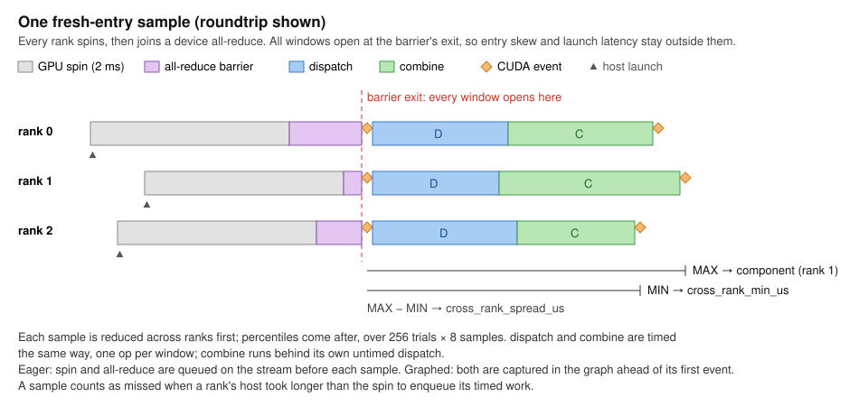
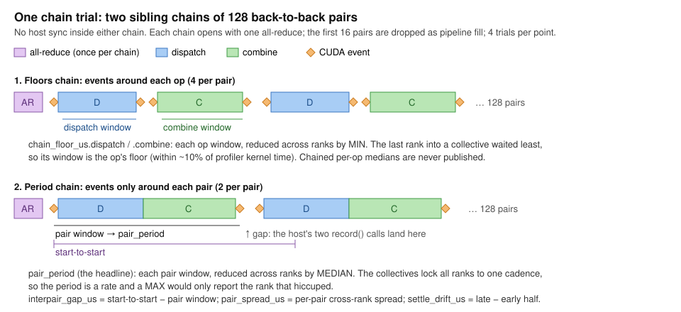

# Summary

What CollectiveX measures, how, and how to read it. The sections after this summary hold the
evidence behind each rule; the [README](../README.md) holds usage and coverage. Where the docs and
`collectivex/bench/` disagree, the code is authoritative.

## Scope and workload

CollectiveX times one MoE layer's expert-parallel communication on real allocations: **dispatch**
sends each token to the ranks owning its top-k experts, **combine** brings the expert outputs back.
No expert compute runs, so it measures neither overlap nor serving throughput, and it does not rank
or recommend.

- **Shape** `deepseek-v4-pro`: hidden 7168, top-k 6, 384 experts, packed placement, uniform
  deterministic routing, proven identical on every rank.
- **`T` is tokens per rank**: decode 1-512, prefill 1024-8192, powers of two. Unreachable rungs go
  in `ladder_dropped`.
- **Precision**: dispatch BF16, or FP8 (per-128-block e4m3, FP32 scales) where the backend supports
  it upstream; combine always BF16.
- **Scale**: EP8 is one 8-GPU node (2x4 MNNVL on GB200/GB300); EP16 is 2x8 over RDMA, or 4x4 MNNVL
  on GB200/GB300.

## Backends run as engines run them

Each backend runs the configuration its reference engine selects, so `production` rows compare
deployed contracts. `production` means an engine can select it today; `candidate` rows describe the
library only. Details are under [Backends](#backends).

| Backend | Maturity | Launch | Engine contract |
|---|---|---|---|
| deepep-v2 | production | graph; normal prefill eager | vLLM `deepep_v2` and `deepep_low_latency`; LL stops at T=256 |
| nccl-ep | production for in-domain zero-copy LL rank-major BF16; library otherwise | graph decode; prefill eager | TensorRT-LLM `NcclEP` with NVIDIA/TensorRT-LLM#20631; HT and FP8 (DS_FP8E3M4) are library rows |
| uccl-ep | candidate | normal eager; LL graph | vLLM's DeepEP configuration on UCCL's drop-in `deep_ep`; no engine ships its selector |
| mori | production | graph decode; eager prefill | vLLM's MoRI IntraNode / InterNodeV1, LL EP16 only |
| flashinfer-ep | production | graph decode; eager prefill | vLLM's integration, GB200/GB300 only |

## Timing

Every window is a pair of CUDA events.

**Fresh entry** times one drained `roundtrip`, `dispatch` or `combine` per sample (256 trials x 8).
Each sample opens with a 2 ms GPU spin and a device all-reduce, so launch skew stays outside the
window, and is reduced across ranks by MAX; MIN and the spread are kept too. A sample whose host
enqueued slower than the spin is a **miss**. See [Rank Alignment](#rank-alignment).

**Chained** times 128 back-to-back pairs with no host sync, 16 dropped as fill, 4 trials:

- **`pair_period`**, the headline: events only around each pair, MEDIAN across ranks.
- **`chain_floor_us`**: events around each op, MIN across ranks; tracks kernel time to about 10%.
- Health: `pair_spread_us`, `interpair_gap_us`, `settle_drift_us`. Chained per-op medians are
  never published.

Graphed rows replay CUDA graphs as engines capture decode; the rest run eager. The two regimes carry
different `kernel_generation` suffixes and never pool.

## Validation

Every case is gated by an oracle before and after timing and after the chain: per-expert transforms,
metadata, counts, payload and a combine model matching each backend's reduction (tolerance 8 x 2^-8
relative). Graphed replays must rewrite poisoned outputs. Any failure makes the case `invalid`.

## Reading results

- Rank on `pair_period` p50. Each case is one run, so a small gap is no result.
- Fresh-entry p90/p95/p99 are withheld once misses reach 10/5/1% of samples. Do not rank
  multi-node decode on fresh-entry p99.
- Bandwidth is logical wire payload over latency, never link utilization.
- FP8 `stage` (the dequant) is excluded from `roundtrip` and `pair_period`; do not sum it in.
- EFA pools (b300, h100) run EP16 through a CPU proxy, so those rows measure the proxy.
- On GB200/GB300, eager FP8 prefill chains at T=1024 are bound by the Grace host, not the fabric.
- Vendor tables time kernels in a profiler; compare them with `cross_rank_min_us` or
  `chain_floor_us`.
- Limits: no compute between ops, uniform routing, no L2 flush, unlocked clocks (`slow_gpu` flags
  outliers), interior chain pairs unvalidated.

# Methodology

CollectiveX runs expert-parallel (EP) communication benchmarks by hand on real accelerator
allocations and writes one result document per case into `collectivex/results/`. Uploading those
files to the CollectiveX database publishes them; they are not committed. CollectiveX does not rank,
recommend or select: the frontend reads `results/cases.json` and the result documents and makes its
own display decisions. The [Summary](#summary) above states the rules in
brief. Where the docs disagree with the code in `collectivex/bench/`, the code is authoritative.

## Product Boundary

CollectiveX is a communication microbenchmark for comparing EP libraries on one chip and topology,
and EP latency and logical payload bandwidth across systems under the same workload. It reports
unsupported, failed, invalid and unstable cases rather than hiding them. It does not predict serving
throughput: no expert compute runs, so it measures neither compute/communication overlap nor a layer.

## Matrix

The workload is `deepseek-v4-pro` (DeepSeek-V4-Pro, the `dsv4` model the rest of InferenceX
benchmarks): hidden 7168, top-k 6, 384 routed experts, packed placement, uniform routing. Each
backend/topology runs one pinned configuration, the one its reference engine runs. The token ladders
live in `configs/sweep.json`: decode T=1..512 and prefill T=1024..8192 tokens per rank, in powers of
two. `normal` mode runs both ladders with `layout-and-dispatch-v1` semantics. `low-latency` runs each
backend's decode kernels on the decode ladder, and nccl-ep's on the prefill ladder too
(`backend_mode_phases`); it is enabled cell by cell from the registry's `ll_backends` map.

`sweep_matrix.py` turns the requested SKUs, backends, EP sizes, modes, precisions and ladders into
shards of one allocation each. A filter produces a smaller matrix, not a different contract.
`results/cases.json` is the committed snapshot of the full matrix, and a unit test fails when it no
longer matches the configs. A cell whose backend runs on that SKU at another EP size is listed as
`unsupported`. Low-latency adds only runnable cells, so a low-latency wall is explained in
[Backends](#backends) rather than listed. Whether a case succeeded is decided only by the
benchmark's return code.

### Ladder Clamps

A backend may clamp the ladder, and `workload.ladder_measured`, `ladder_dropped` and `ladder_cap`
record what ran. DeepEP V2, UCCL-EP and MoRI allocate their low-latency receive at 256 tokens per
rank (vLLM's batched-DP budget; for MoRI, the harness's shared cap), so their low-latency ladders stop
at 256. NCCL EP sizes its group to the ladder's top and runs every rung. DeepEP V2's receive is sized
from a constant rather than the ladder, so clamping around a kernel defect cannot change the
footprint. That was used once: DeepEP's low-latency combine corrupted the 256 rung on every
Blackwell SKU until the pin moved to upstream main with
[DeepEP #642](https://github.com/deepseek-ai/DeepEP/pull/642), a CTA-scope fence before the combine
staging buffer is recycled.

### Precision

Combine is always BF16. Dispatch is a BF16 control plus, on backends whose FP8 dispatch is supported
upstream, an FP8 dispatch (`BACKEND_PRECISIONS` in `sweep_matrix.py`). Every FP8 codec is per-128-block
e4m3 with FP32 scales on the wire: 7168 value bytes plus 224 scale bytes per copy.

- **MoRI** quantizes as vLLM's MoRI `prepare()` does for a block-quantized model (aiter `per_1x128`),
  in e4m3fnuz on gfx942 and OCP e4m3fn on gfx950.
- **UCCL-EP** quantizes per token and per 128 channels, e4m3fnuz on gfx942 and e4m3fn elsewhere.
- **Blackwell low-latency** (DeepEP and UCCL-EP) rounds scales to powers of two and hands the receiver
  packed UE8M0 exponents, as vLLM's DeepEP LL path asks when its expert GEMM takes UE8M0 scales. The
  wire still carries FP32 scales. Those rows carry the `-ue8m0` generation suffix.
- **`normal`-mode codecs** of DeepEP V2, UCCL-EP and FlashInfer EP keep unrounded FP32 scales, where
  vLLM rounds them on its DeepGEMM E8M0 path: byte-identical and timing-neutral, not bit-identical.
- **NCCL EP** uses its internal DS_FP8E3M4 recipe, for low-latency prefill and decode, with a BF16
  combine. FP8 dispatch zero-copies under the same conditions as BF16, registering both the token and
  scale windows. It runs in the default matrix as a library row: TensorRT-LLM's `NcclEP` sends
  DeepSeek-FP8 activations in BF16. NCCL EP's normal mode stays BF16-only.

The caller-side quantize is **inside the measured dispatch**, because a forward pass pays it on the
critical path. On DeepEP V2, UCCL-EP, FlashInfer EP and MoRI it is one compiled kernel, checked
bitwise against its eager reference before timing. The DeepEP V2 and UCCL-EP low-latency kernels
quantize internally. So an FP8 `normal` dispatch covers quantize plus transport, and its BF16
control covers transport alone. Read that charge as a fixed per-call cost, not a payload-proportional
one, and compare FP8 with BF16 at the top of the ladder: at small T the FP8 path moves fewer bytes but
carries the quantize launch, and by T=512 the halved payload repays it.

`implementation.fp8_consume` names the FP8 consumption the chained roundtrip models. `native`, the
default, has the expert GEMM consume the dispatched FP8 and scales directly, as vLLM and SGLang do for
this 128-block shape. `CX_FP8_CONSUME=dequant` stages every pair from its own dispatch, modelling
vLLM's quant-format mismatch fallback. It is a verification hatch, not a second metric, because the
mismatched cost is derivable from what every run emits (`dequant roundtrip ~= roundtrip + stage`,
within 2.4% on b200). The reverse does not hold, so measure native and derive dequant.

## Backends

Each backend runs the configuration its reference engine selects: vLLM, except TensorRT-LLM for NCCL
EP low-latency (as of NVIDIA/TensorRT-LLM#20631; see [nccl-ep.md](nccl-ep.md)).
`implementation.maturity` is `production` where an engine can select the configuration today and
`candidate` where the row describes the library ([Result Document](#result-document)). Compare
`production` rows for deployed contracts.

### DeepEP V2

DeepEP V2 is the `ElasticBuffer` of [DeepEP #605](https://github.com/deepseek-ai/DeepEP/pull/605).
The pin in `runtime/common.sh` is upstream `main`, which also carries #630 (pure scale-up init without
GIN), #640 (NCCL shared-memory mappings) and #642 (the low-latency combine fence). The adapter fails
closed unless the loaded `deep_ep` exposes `ElasticBuffer`, which also catches an image-bundled
`deep_ep` shadowing the build.

`normal` runs vLLM's `deepep_v2` configuration (`library_config.engine_contract = "vllm"`). With CUDA
graphs on, vLLM's default, every batch, prefill as well as decode, dispatches with `do_cpu_sync=False`
and `do_expand=False` into a receive bounded at the next power of two of T, with
`prefer_overlap_with_compute=False` (DeepEP then sizes its kernels at 64 SMs) and
`allow_multiple_reduction=False`. No deepep-v2 dispatch waits on the host. Decode replays a graph and
prefill runs eager, as vLLM runs large prefill batches uncaptured.

Scale-up cases request NCCL Device API LSA and fail closed unless the LSA team covers the whole EP
world, which is also what makes the hybrid choice match vLLM's autoselect: DeepEP goes hybrid only
when the LSA team is smaller than the world. x86 EP16 is that hybrid path, GIN across two scale-out
domains of eight scale-up ranks each. GB EP16 stays inside MNNVL and uses LSA. Hybrid EP16 allocates
33 GIN QPs per peer (a fixed 512-QP budget) instead of the automatic 65/129, which exhausts the
per-NIC QP budget on CX-7. DeepEP's SM model reads the scale-out rate from an `ibstat` probe that cannot
see EFA and that the vLLM image does not ship, so on the EFA pools and on h200-dgxc the registry's
`network.rdma_gbs` supplies the per-GPU rate and the resulting count is passed explicitly
(`library_config.sm_model_rdma_gbs`).

**A virtualized pool can make a scale-out row measure the hypervisor.** ElasticBuffer registers its GIN
window `NCCL_WIN_STRICT_ORDERING`, which strips PCIe relaxed ordering; in h200-dgxc's KVM guests
strict-ordered GPU-NIC writes cap near 10 GB/s per GPU. The build patches the registration behind a
switch a pool opts into with `rdma_relaxed_ordering` in its `network` block: h200 bf16 decode at T=512
drops from 3088 µs to 620 µs per roundtrip, oracle green in both precisions. Upstream made the window
strict on purpose (DeepEP #661/#674), since a relaxed GIN signal can in principle overtake its data;
that race has not been reproduced, and a passing oracle does not rule it out. Those rows carry
`-relaxed-ordering` and never pool with the strict series.

`low-latency` drives the legacy `deep_ep.Buffer` IBGDA decode kernels, which deliver a per-expert
padded receive and apply the gate weights inside a source-side combine (weighted-kernel-sum). It
builds and calls them as vLLM's `deepep_low_latency` path does: `num_qps_per_rank` equal to the local
expert count, NVLink allowed, MNNVL allowed only on the GB pools (`VLLM_DEEPEP_LOW_LATENCY_USE_MNNVL`),
and each collective split into a send kernel and a receive hook that runs straight after it. EP8
runs over intra-node NVLink; multi-node EP16 rides NVSHMEM IBGDA, which wants gdrdrv on the node
(b200-nscale's bare-metal IB has it), and GB EP16 stays inside MNNVL. B300 registers no DeepEP
low-latency: the legacy Buffer initializes NVSHMEM with an RDMA transport even on one node, and
NVSHMEM aborts on topology detection over B300's EFA.

### UCCL-EP

[UCCL](https://github.com/uccl-project/uccl) EP is an API-identical DeepEP replacement that keeps the
legacy `Buffer` but routes scale-out over CPU proxies issuing GPUDirect RDMA on plain `libibverbs`.
Its scale-up is single-node `cudaIpc`, never MNNVL, and proxies start only across nodes. No engine
ships a UCCL selector, so its rows stay `candidate`, but engines deploy it as a drop-in `deep_ep`
under vLLM's DeepEP backends, and the adapter runs that configuration.

`normal` is vLLM's `deepep_ht` path: UCCL's default 20 SMs, `get_dispatch_config`/`get_combine_config`
per call, 1 GiB of NVLink buffer, plus 1 GiB of RDMA buffer and 10 QPs per rank across nodes. Its
dispatch polls receive counters on the host before launching the transfer, so `normal` stays eager and
passes through the host gate ([Rank Alignment](#rank-alignment)). `low-latency` issues the same calls
as DeepEP V2 (send kernel plus receive hook) with vLLM's 256-token receive; at EP8 `is_intranode`
keeps it on NVLink. UCCL-EP is built from source at its pin with UCCL's drop-in flags
`USE_DMABUF=1 PER_EXPERT_BATCHING=1`; `implementation.library_version` names the commit and flags,
and the import probe rejects any other `deep_ep`.

UCCL-EP EP16 is not registered on mi355x: its CPU-proxy RDMA works over the Pollara fabric but runs
about 13x under UCCL's documented bandwidth, unchanged by registration mode or traffic class (an
ionic-driver suspect).

### MoRI

`normal` runs vLLM's MoRI configuration (`MoriAll2AllManager`) under MoRI's default MANUAL launch mode.
One node runs IntraNode at block_num 80, rdma_block_num 0 and 16 warps per block; two nodes run
InterNodeV1 at 64/32/8 on gfx950 (32/16/16 on gfx942). One QP per PE, an external input buffer and
combine `quant_type` `none`. `library_config` records the tuple the handle realized, and the adapter
fails closed if it differs from the request.

Warp count and buffer mode are pinned together: MoRI's tuning keys combine on `zero_copy`, and 16
warps loses 13-78% against 8 with a registered buffer but wins 9-27% from T=128 up with the external
input the engines run. These rows describe the engine-integrated configuration, not MoRI's peak:
its shipped per-shape tables reach a faster combine (0-15% depending on arch) with tuples no engine
selects.

MoRI EP16 runs InterNodeV1 across two nodes with the STATIC_HEAP symmetric heap, and a scale-out case
fails closed under any other heap mode: `VMM_HEAP` corrupts cross-node combine on ROCm 7.2, where uncached VMM allocations
read stale lines (ROCm/mori#610). `combine()` takes the rank's own routing tensor, never dispatch's
recv-slot indices, because InterNodeV1 keys its node predicate by the rank's own token id
(ROCm/mori#475). `low-latency` follows vLLM's `mori_low_latency`, which differs only across nodes:
`InterNodeV1LL` with the arch's tuple, so MoRI has no EP8 low-latency cell. `MORI_ENABLE_SDMA` stays
unset, as vLLM leaves it; a row run with it set carries `-sdma`.

### NCCL EP

NCCL EP is NVIDIA's MoE dispatch/combine on the NCCL Device API, shipped as the `nccl-extensions`
wheel. [nccl-ep.md](nccl-ep.md) documents its engine contract, row identity and wheel pin. It runs EP8
and EP16 on all six NVIDIA SKUs: EP16 stays inside MNNVL on GB200/GB300 and is a 2x8 scale-out over
the cross-node GIN path on H100, H200, B200 and B300.

`normal` selects `HIGH_THROUGHPUT`, whose FLAT receive and unweighted rank-sum combine match
`layout-and-dispatch-v1`. No engine runs it, so HT rows are `candidate`. Its timed dispatch carries
`ncclEpUpdateHandle`, the per-step routing update the API requires before every dispatch whose
routing changed, as every backend's dispatch carries its routing work. The update's HT work is sized
by the handle's capacity, not by T, so every rung carries a term set by the ladder's top. NVIDIA's
`ep_bench` excludes it.

`low-latency` runs TensorRT-LLM's `NcclEP` configuration: rank-major receive with caller-side weighted
pre-reduction, an unweighted rank-sum combine, and one group sized to the ladder's top. Dispatch writes
a registered window directly within one LSA/MNNVL domain, graphed or eager, and scale-out stages, as
TensorRT-LLM does with NVIDIA/TensorRT-LLM#20631. The v0.2 wheel ships the combine fence the v0.1
port lacked, so the ladder runs unclamped. The adapter binds one handle per group and rebinds it per
point, because two handles from one group share its double-buffer parity slots
([NVIDIA/nccl#2303](https://github.com/NVIDIA/nccl/issues/2303)).

### FlashInfer EP

FlashInfer EP is TensorRT-LLM's one-sided MNNVL `MoeAlltoAll` from FlashInfer 0.7.1, vLLM main's pin:
each rank writes tokens directly into its peers' workspace windows, so it is GB200/GB300-only and runs
EP8 and EP16 inside MNNVL. It has one kernel family, so it runs `normal` only, across both ladders.
It runs vLLM's integration (`flashinfer_nvlink_one_sided`): combine is handed a caller-owned payload
with `payload_in_workspace=False`, so FlashInfer's staging copy into the workspace runs, and is timed,
inside `combine`, as in vLLM (writing the expert output into the workspace directly is TensorRT-LLM's
path). FP8 dispatch is DeepSeek blockwise FP8 carried as a fourth payload (vLLM v0.29.0+). Through
0.6.15 the combine accumulates in BF16 with a pairwise slot tree, which the oracle models exactly
(`combine_reduction = "topk-slot-tree"`); 0.6.16 moved to FP32, and the adapter picks the model from
the installed version. Graph replay cuts gb200 EP8 T=1 from 151 µs to 43 µs, so decode replays.

## Workload Identity

One deterministic workload is generated over the global token batch from the workload's seed and
sliced by source rank. A keyed BLAKE2b counter over (token, slot, attempt, stream) gives byte-identical
expert indices and gate weights on every runtime, and the harness proves the routing trace identical
across ranks before a case can succeed. Token-expert assignments (expert compute load) and
rank-deduplicated token copies (EP activation traffic) are kept distinct; adapters may not generate
routing or reinterpret one as the other.

## Measurement

Every window is a pair of CUDA events on the stream. `roundtrip` means dispatch then combine, the
transport. Expert-output staging is outside it and outside isolated combine, and is reported as its
own `stage` component where it does device work (the `dequant` hatch puts it back on purpose).

**`stage` is harness scaffolding, not a serving phase.** Under FP8 it converts the received payload
to the BF16 combine sends, standing in for the expert GEMM that reads FP8 natively in production. Do
not sum it into a total or compare it across backends: each adapter converts a different amount (only
the received rows, the whole padded plane, or, for FlashInfer, only filled slots).
`implementation.stage_excluded_from_roundtrip` means device-work staging existed and was hoisted out;
`false` covers both "nothing to stage" (every BF16 row) and the `dequant` hatch. `isolated_sum` is
derived: isolated dispatch plus combine, never `stage`.

Each point measures two families:

- **Fresh entry** (`roundtrip`, `dispatch`, `combine`, and eager `stage`): one aligned call per
  sample, reduced across ranks by MAX, because a layer finishes with its slowest rank.
  [Rank Alignment](#rank-alignment) describes how each sample opens.
- **Chained** (`pair_period`, `chain_floor_us`, `chain_health`): pairs issued back to back with no host
  sync, as a decode loop issues them. `pair_period` is the **headline** for every row, graphed or
  eager. See [Chained Pair Period](#chained-pair-period).

Every row also carries `cross_rank_min_us` (the same samples reduced by MIN) and
`cross_rank_spread_us` (roundtrip MAX minus MIN). Alignment removes entry skew, but ranks still leave a
window unevenly, so read MAX and MIN as a bracket: two cells whose MAX gap is smaller than the larger
spread are not separated by the data. Do not rank multi-node decode cells on p99 of MAX, which
worst-rank stalls dominate. The isolated `dispatch` and `combine` inherit the preceding op's exit
stagger, so treat them as diagnostics; the paired roundtrip is the comparable fresh-entry quantity.

### CUDA Graph Replay

Serving engines capture their decode step, so graph-compatible pairs replay `CUDAGraph.replay()` at
decode by default, as each backend's engine captures it. Prefill stays eager everywhere, as engines run
it, and `COLLX_CUDA_GRAPH=0` restores eager everywhere.

- **deepep-v2** `normal` and `low-latency` decode.
- **nccl-ep** low-latency and HT decode. Graphed low-latency within one domain takes the window path
  (`-zc`), as TensorRT-LLM's captured decode does with #20631; scale-out stages. HT's per-step
  routing `ncclAllGather` is the one host NCCL collective in any capture, so the communicator runs
  NCCL graph usage mode 1: the default mixing mode left ~14 µs idle before each captured all-gather.
  Those rows carry `-gum1`. Across nodes NCCL fronts the captured all-gather with a host-callback node
  (about +50 µs of dispatch at EP16).
- **mori** `normal` and `low-latency` decode. ROCm torch before 2.13 rejects external events, so the
  timing events are captured with `hipEventRecordWithFlags(..., hipEventRecordExternal)`.
- **flashinfer-ep** decode.
- **uccl-ep** low-latency, intranode only; `normal` host-syncs and stays eager.

Only the launch mechanism changes. Each fresh-entry component captures one pair, with the alignment
captured ahead of the first timing event (origin `cuda-graph-replay`; `stage` is not timed
separately). Each chain sibling is one graph of 128 unrolled pairs, replayed once to upload and once
timed. Capture uses torch's default `global` error mode, as vLLM's and SGLang's decode captures do,
so a capture-unsafe call fails instead of being recorded. Graphed rows carry `-cudagraph-spin-ar` on
`kernel_generation` and eager rows `-eager-spin-ar`, so the two never pool.

### Rank Alignment

Every fresh-entry sample opens the way DeepEP's `bench_kineto` does: a GPU spin, then a device
all-reduce, with no host sync before the start event. The spin lasts 2 ms of wall time
(`COLLX_ALIGN_SPIN_US`), calibrated after each warm-up because `torch.cuda._sleep` counts cycles. It
outlasts the host's enqueue of the sample, so the last rank to arrive already has its timed work queued
when the all-reduce releases everyone, and every window opens at the barrier's exit: entry skew and
the first kernel's launch latency both leave the window. Eager rows queue the spin and all-reduce
before each sample; graphed rows capture them in the graph ahead of its first event, so no host
handoff follows the alignment. Before the all-reduce moved into the graph, a late host launch stalled
the other ranks inside the window (gb200 flashinfer EP8 T=1 roundtrip p99 858 µs); in-graph, graphed
decode roundtrip p99 runs 1.01-1.19x its p50. That is why graphed rows publish tails. On ROCm, where
HIP submits a replay node by node from the host, the spin is what gives a lagging host time to submit
the whole replay before the barrier releases anyone.

A sample is **missed** when some rank's host took longer than the spin to finish enqueuing its timed
work (eager) or to return from its replay call (graphed). Garbage collection is off for every timed
series. Rows publish `rank_alignment.missed_samples` per series and `missed_fraction`, and the
fresh-entry tails are withheld once missed or host-stalled samples could fill them: p99 at 1%, p95 at
5%, p90 at 10%. `implementation.rank_alignment` records the method and the spin.

`combine` (and eager `stage`) is timed behind its own untimed dispatch, so its window inherits that
dispatch's exit stagger. A dispatch that waits on the host (uccl-ep `normal`) runs before the
alignment, so the spin is not spent on its wait.

**Host-synced series wait out a throttled host.** In uccl-ep `normal`, the host's poll and relaunch
sit inside the window, which is their production cost. While uccl-ep EP16 runs, b200-nscale nodes
intermittently drop every core to about 200 MHz for 100-200 ms every 2-5 s (the platform's response to
uccl-ep's 32 busy-polling proxies per node; never idle, never under deepep-v2), which put ~1% of EP16
decode samples at 1-2 ms. So each sample of these series first times a ~20 µs loop of interpreter
work outside the window and keeps probing while it runs more than 2.5x slow; the other ranks wait at
the barrier. A second probe after the sample catches a throttle that began inside it. A sample waits
at most 0.5 s and a run 60 s. Rows publish `host_held_samples` (start held more than 1 ms) and
`host_stalled_samples` (a probe more than 5x slow; these gate the tails like missed samples), with
their largest series shares; all four are null where the dispatch does not wait on the host. The probes
see only the two ends of a sample, and nothing flushes L2 between samples.

Each chain sibling is aligned once, by the all-reduce alone when eager: a spin in front lets the host
queue a backlog the GPU drains faster than the host refills it, mixing two speeds into the kept pairs.
A graphed sibling keeps the captured spin, since its replay is one host call. In host-synced modes
each eager sibling also passes the host gate, and every rank restarts it together, up to three times,
if any host ran throttled (`chain_health.host_retried_siblings`, `host_stalled_trials`).

### Chained Pair Period

Fresh-entry components start every sample from an idle pipeline. A decode loop never stops, and what it
pays per MoE layer is the pipeline's steady-state **period**. `benchmark_chain` issues dispatch→combine
pairs back to back with events enqueued on-stream and no host sync inside the loop, drops the first 16
pairs as pipeline fill, and pools 4 trials per point over the same rotated ladder order as the
fresh-entry pass. The pairing is `run_roundtrip`'s, so `pair_period` excludes staging on the same rule
`roundtrip` does.

Each trial runs **two sibling chains** of 128 pairs, so the statistics do not carry the
instrumentation that collects them. One chain with six `record()` calls per pair charged the inner
records into the period wherever the device drained faster than the host enqueued, a roughly
T-independent 10-30 µs on every vendor at once. So a **floors chain** runs first with only the four
op-window events, and a **period chain** second with only the outer pair events, whose host cost lands
in the inter-pair gap.

- `components.pair_period` (origin `chained-median`): each pair window, reduced across ranks by MEDIAN.
  The period is a rate: the collectives phase-lock every rank into one cadence, and a MAX would publish
  whichever rank hiccuped.
- `chain_floor_us.dispatch` / `.combine` (origin `chained-cross-rank-min`): each op window, reduced by
  MIN. The last rank into a collective waited least, so its window is the op's floor, within ~10% of
  profiler kernel time. `period - Σfloors` has meaning in both signs. Positive is per-pair inter-rank
  wait, which on a synchronization-dominated backend sits flat in T (`period = max(sync budget, work)`).
  Negative is the floors chain's own record cost inflating its windows where the device outruns the
  host.
- `chain_health.pair_spread_us`: per-pair cross-rank spread. Large next to `pair_period` means a paced
  or slow rank, and the point is not a steady-state period.
- `chain_health.interpair_gap_us`: start-to-start median minus pair-window median, the cost outside
  the window and the regression guard against the six-events defect.
- `chain_health.settle_drift_us`: late-half minus early-half period, the proof that 16 dropped pairs
  were enough.

**Chained per-op medians and p99s are never published.** Without a host sync, each rank's wait parks in
whichever op window it happens to block in: stable per rank, arbitrary across ranks, bistable across
runs, while the pair period is conserved. Only the period and the MIN floor are stable.

**The period is always free-running.** Ranks may drift by up to about one iteration, which is sound
only where the receive plane tolerates it: every backend double-buffers per dispatch, enforces strict
pairing, or completes each op on a reusable handle, and DeepEP V2 `normal` passed an un-synchronized
256-pair hand probe at EP8 and EP16 in both precisions. A backend that cannot run free needs a fix,
not a variant: re-aligning ranks between pairs adds its own ~10 µs and removes the overlap the
measurement exists to capture.

**An eager chain can be host-bound.** Prefill chains are eager, so the host enqueues every pair. Where
its per-pair cost exceeds the GPU's pair time, the slowest host sets the cadence and the other ranks
wait inside dispatch: on GB200/GB300 the Grace host makes deepep-v2 normal FP8 prefill at T=1024 run
above its aligned roundtrip (EP8 227-229 µs against 197 µs). The aligned `roundtrip` is the transport
number there.

### Timing Profile

One timing profile, defined in `configs/sweep.json` and recorded in `measurement.sampling`:

- Fresh entry: 256 trials x 8 timed iterations = 2048 samples per component.
- Chained: 4 trials x (128 pairs - 16 dropped) = 448 pairs for the period and 448 for the floors.
- 32 full dispatch-stage-combine warm-ups before each component at every trial and point, and before
  each chain trial.
- Component order rotates each trial (`trial_order`) over a per-trial-rotated ladder.
- Each fresh-entry sample is reduced across ranks by MAX before nearest-rank p50/p90/p95/p99.

Ascending through the ladder, each shape gets 8 untimed roundtrips to settle clocks, fabric and buffer
state before it is correctness-checked; all timing happens after every shape is warmed and checked.
Decode and prefill name the serving regime; they do not change the timed primitive.

### Vendor Tables

Vendor microbenchmarks for these kernels variously time the kernel alone through a profiler (DeepEP,
UCCL low-latency), replay graphs (MoRI), average across ranks rather than take the max, and report the
best of a config sweep. Expect this suite's headline to read above such a table by at least the
max-versus-mean gap; `cross_rank_min_us` and `chain_floor_us` are the figures to place beside one.

### Bandwidth

Rows carry bytes and latency, not bandwidth: `bandwidth.py` and the dashboard derive logical payload
bandwidth as `wire_payload_bytes / measured_latency_seconds`. Both byte accountings exclude metadata,
padding and buffer capacity.

- `byte_provenance` is the comparable basis: one copy per unique (token, destination rank).
- `wire_byte_provenance` is what the kernels move: the same for every rank-deduplicating layout (every
  `normal` mode, MoRI InterNodeV1LL, NCCL EP rank-major), and one copy per (token, expert) for the
  low-latency kernels that weight inside combine (DeepEP V2, UCCL-EP, NCCL EP expert-major).
  Bandwidth divides the wire basis; `logical_copies` states which applies.

FP8 dispatch moves 1 byte per value plus per-128-block FP32 scales; combine stays BF16, so the two
directions can differ and the roundtrip is their sum. Logical bandwidth is never labelled physical,
and bus bandwidth or link utilization are not derived. `token_rate_at_latency_percentile` divides
global tokens by each roundtrip percentile.

## Correctness

An implementation-independent oracle uses an expert-specific deterministic transform, so wrong routing
cannot pass an identity roundtrip. For every rank and point it verifies:

1. destination rank and expert, source token, multiplicity, gate weight and receive counts;
2. dispatched payload and metadata before timing;
3. combined output before timing;
4. unchanged semantic inputs through all timed samples;
5. dispatched payload, metadata and combined output again after timing;
6. the free-running chain's final combined output, once per chain trial, against a drained pair
   through the same path;
7. the full checks 2-5 again against the state the chain leaves behind;
8. under graph replay, that every timed capture's poisoned output was rewritten by its replay, and that
   a capture with staging inside it, replayed after its inputs are scaled by 2 in place and its outputs
   poisoned, matches an eager drained pair on the scaled inputs (a replay that re-sent captured data
   fails).

Every check folds into `correctness.passed`; any failed rank or point makes the case `invalid`. Checks
6 and 7 exist because 2-5 see only drained calls: without them a backend that corrupts under
back-to-back pairs would present as the fastest cell. Check 6 compares within the oracle's tolerance
(combine kernels need not be order-deterministic); interior chain pairs stay unvalidated by design,
since holding every output would put work inside the timed loop.

**Check 6 gates only where the chain stages per pair**, and reports `null` elsewhere. Every FP8 row
hoists staging out of the chain by default, so the chain's final combine and the drained reference
consume differently mismatched inputs and nothing requires them to agree (on h100 deepep-v2 the hoisted
error was 1000-3000x tolerance, the per-pair `dequant` run bit-identical). It keeps its teeth on every
BF16 row and under the `dequant` hatch. What `null` leaves uncovered is a corruption that appears only
under free-running pairs, leaves no state behind, and lives in a path the BF16 sibling does not
exercise. Run `CX_FP8_CONSUME=dequant` whenever an FP8 period moves in a way its BF16 sibling does not,
and before publishing a new FP8 backend. `correctness.chain_last_output_error` is published whether or
not the verdict passed: read the magnitude before the verdict, since a coarse accumulator and a
corruption call for opposite responses.

Every `normal` mode, MoRI InterNodeV1LL and nccl-ep rank-major low-latency use an unweighted rank-sum
combine. The oracle builds each rank's gate-weighted FP32 expert aggregate, casts it to BF16 as the
adapter does, and reduces per `implementation.combine_reduction`:

- `domain-fp32` (uccl-ep, MoRI, nccl-ep HT, FlashInfer from 0.6.16): ranks in one scale-up domain
  reduce in FP32, and each domain casts its partial to BF16 before the scale-out sum.
- `rank-fp32` (deepep-v2, nccl-ep low-latency rank-major): the source sums the first slot of each
  unique destination rank in FP32, since deepep-v2 runs `allow_multiple_reduction=False` and forms no
  per-domain partials. On x86 EP16 that moves one scale-out row per destination rank, about 2.6x the
  per-node combine bytes; the `token-rank` byte basis already counts it.
- `topk-slot-tree` (FlashInfer before 0.6.16).

The gate is the max elementwise relative error, denominator clamped at 0.02, below `8 * 2^-8`. The other
low-latency adapters weight inside combine, so the oracle derives a per-(source, expert)-slot gate-scaled
sum of BF16 messages instead and checks the delivered assignments against the routing trace. Under FP8
the oracle applies the backend's exact quantize round-trip to the semantic payload, so the payload match
stays bit-exact and the tolerance does not widen. Physical receive order is not a correctness property.

## Result Document

One raw case document, `results/<sku>/<case_id>.json`, carries `record_type: "case-attempt"`, the
sweep `version` and `generated_at`, and:

- `identity`: `case_id`, `attempt_ordinal`, `case_factors` (SKU and scheduled case) and
  `allocation_factors` (source SHA; run id and attempt are null for hand runs).
- `workload`: `cross_rank_consistent`, `ladder_measured`, `ladder_dropped`, `ladder_cap`.
- `measurement`: dispatch and combine dtype, `combine_semantics`, `payload_unit`, `sampling`, and the
  per-point `rows`.
- `implementation`:
  - `name` and `kernel_generation` ([Identity](#identity)).
  - `maturity`: `production` where an engine can select the configuration today (vLLM's
    `--all2all-backend`, SGLang's `--moe-a2a-backend`, or TensorRT-LLM's `NcclEP` for NCCL EP's
    low-latency rank-major BF16 rows); `candidate` for a transport or mode no engine ships a selector
    for. uccl-ep stays `candidate` although it runs vLLM's DeepEP configuration. nccl-ep sets it per row.
  - `fp8_consume`, `rank_alignment`, `stage_excluded_from_roundtrip`, `chained_period`,
    `cuda_graph_supported` and `cuda_graph_replay`.
  - `combine_reduction` and `library_version` (the installed wheel or pinned commit).
  - `library_config`: what the adapter chose or the library resolved that changes what a row measures
    (`EPBackend.implementation_details()`): SM and QP counts, buffer flags and sizing, zero-copy,
    `engine_contract` and similar, per backend.
- `topology`: device, placement, `gpus_per_node`, `nodes`, `scale_up_domain`, `scope`,
  `topology_class`, `world_size`, `scale_up_transport`, `scale_out_transport` and the derived
  `transport`.
- `runtime`: vendor, torch, CUDA or HIP, the loaded `nccl`/`rccl` version, and `gpu_clocks`. A clamped
  GPU looks exactly like a slow library, so every case records each rank's SM clock after each point's
  timed bursts and after each chain (NVML or amdsmi), throttle fractions by cause,
  `sm_clock_ratio_min` (slowest over fastest rank) and `slow_gpu` (ratio below 0.95, a hardware,
  thermal or power brake, or 5% of the timed passes throttled). Reads happen only between bursts; a
  probe that cannot start leaves nulls and never fails the case.
- `provenance`: image tag, source SHA and `source_dirty` (a dirty result is never published).
- `outcome`: `status` (`success` or `invalid`) and `reasons`.

Each `rows` entry carries the components, `pair_period`, `chain_floor_us`, `chain_health`, the skew
bracket, `rank_alignment`, `correctness`, the byte accounting, receive counts, routing load and the
token rate. Each run writes exactly this one document per case, replacing the case's previous file;
unsupported or never-run cells produce no record.

## Identity

- `case_id`: `{sku}-{backend}-{workload}-{mode}-{phase}-ep{ep}-{routing}-{precision}`, slug-normalized.
  It names the result file, so a re-run replaces that case in the next uploaded run.
- `attempt_ordinal`: `COLLX_ATTEMPT_ID`, 1 unless set.

The backend does not compute cohorts, comparisons or recommendations; a reader decides how to compare
cases. `implementation.kernel_generation` names the kernel family plus the regime suffix
(`-cudagraph-spin-ar` or `-eager-spin-ar`), and rows of one backend pool only within one generation:

| Backend | Families |
|---|---|
| deepep-v2 | `v2-elastic-buffer-vllm-nosync`, plus `-relaxed-ordering` on h200 EP16; `legacy-buffer-ll-hook`, plus `-ue8m0` for Blackwell FP8 |
| uccl-ep | `uccl-legacy-buffer-vllm-ht`; `uccl-legacy-buffer-ll-hook`, plus `-ue8m0` for B200 FP8 |
| mori | `intranode-vllm`, `inter-node-v1-vllm`, `inter-node-v1ll-vllm`, each plus `-sdma` when SDMA was on |
| nccl-ep | `nccl-ep-v02-ht-routed-zc-static` (plus `-gum1` graphed), `nccl-ep-v02-ll-rm` (plus `-zc` on the window path) or `nccl-ep-v02-ll-em`, then `-fp8-ds-e3m4` and `-cap<N>-<wheel version>` ([nccl-ep.md](nccl-ep.md)) |
| flashinfer-ep | `flashinfer-mnnvl-one-sided-staged-<wheel version>` |

Backend source pins live in `runtime/common.sh` and are enforced by exact fetched-commit comparison.

## Execution Isolation

Every non-MNNVL scale-out case needs the registry's `rdma_devices` for its approved fabric; the launcher
rejects a missing or malformed selector, and HCAs are never guessed. `socket_ifname` pins the cross-node
socket interface. After allocation every scale-out node must show its socket interface up and an ACTIVE
port on every listed device before backend initialization. Every shard first clears the NCCL, NVSHMEM,
MoRI and UCCL selectors it inherited, and host-side utility steps receive only a minimal environment.

On the IB and RoCE pools, scale-out NVIDIA forces `NCCL_NET=IB` so a socket fallback fails instead of
being mislabelled RDMA. Device lists use NCCL's `=` exact-match prefix (`mlx5_1` cannot select
`mlx5_10`). `ib_gid_index` applies only when every selected port is Ethernet; native IB keeps its LID
path, and mixed lists are rejected. `rdma_service_level` and `rdma_traffic_class` set the matching
NVSHMEM, NCCL, MoRI, UCCL and DeepEP variables. Scale-out pins `NCCL_IB_MERGE_NICS=0`, because a fused
dual-port device disables NCCL GIN, which DeepEP V2's hybrid EP16 needs. A rail-isolated fabric adds
`NCCL_CROSS_NIC=0`. Selectors come from the tracked registry, whose `network` block wins over an
operator document, and appear only in mode-0600 private logs.

The EFA pools (b300 and h100-dgxc) reach the fabric only through the aws-ofi-nccl libfabric plugin.
Multi-node shards bind the host's `/opt/amazon/{efa,ofi-nccl}` and rdma-core read-only, ahead of the
image's older EFA user space; the IB selector family stays unset, `NCCL_NET_PLUGIN=ofi` and
`FI_PROVIDER=efa` select the plugin, and setup fails unless libfabric reaches every listed device from
inside the container. NCCL GIN rides the plugin's CPU-proxy GIN (`NCCL_GIN_TYPE=2`), which needs
GDRCopy 2.5+ on the node. The type is pinned because the plugin's GPU-initiated EFA backend has only
weak signals, which nccl.ep and DeepEP cannot use. Where the host plugin predates 1.21 (h100's 1.20),
shards build aws-ofi-nccl 1.21.1 into the backend cache, since 1.20's proxy applies every signal with
an inline GPU read-modify-write (1.3-4.5x slower on b300 EP16). Proxy GIN still bounds these rows
well below the IB pools.

The single-slurm pools (H100, H200, B200, B300) reject an allocation holding a GPU with an active
thermal slowdown or above 90 °C and retry elsewhere, up to three allocations: one clamped device paces
every rank.

Repository staging copies `collectivex/` into a mode-0700 execution child of the operator's
`stage_dir` (or beside the image under `squash_dir`), visible at the same path on the login node and
every allocated node. Cleanup waits for confirmed allocation teardown and removes only that child.
Pinned sources are fetched on the submit host before allocation, at the exact pinned revision, because
compute nodes may have no network.

## Image Pinning And Build Isolation

Enroot imports each configured image tag into one squash per (platform, reference), staged once per
cluster and reused. Freshness is decided by the registry manifest digest resolved at launch against a
sidecar stamp: a moved tag forces a fresh import, an unresolved digest reuses what is staged, and
`COLLX_IMAGE_REFRESH=1` forces an update. Validity is proven per use (`unsquashfs -l`), and a squash
another account owns is reused when readable and current but never replaced.

Backends the image does not ship live in a mode-0700 cluster-local backend cache mounted as `/cx-cache`:
DeepEP V2 and UCCL-EP built at their pins, the `nccl-extensions` wheels, FlashInfer at vLLM's pin, and
aws-ofi-nccl 1.21.1 where needed. Each cache directory's name binds the CPU architecture, the image and
the pin (plus the GPU architecture and build-recipe generation for GPU builds), and it is never
committed. The DeepEP V2 build applies one local patch, the opt-in relaxed-ordering switch; UCCL-EP's
AMD build swaps managed allocations for pinned host memory. MoRI ships in the image and is only
import-checked. Runtime probes fail closed before reuse, and a cache that fails them is rejected, not
reset, so a concurrent allocation cannot lose files it is using.

## Result Delivery

There is no results server. Each shard runs one allocation and copies its per-case documents to
`results/<sku>/` in the checkout that ran it. Results reach the dashboard only through the
InferenceX-app upload (`admin:db:ingest:collectivex --dir`), which checks every file against
`results/cases.json`, rejects ones measured from uncommitted code, and rejects IP addresses and
host-identifying fields.
