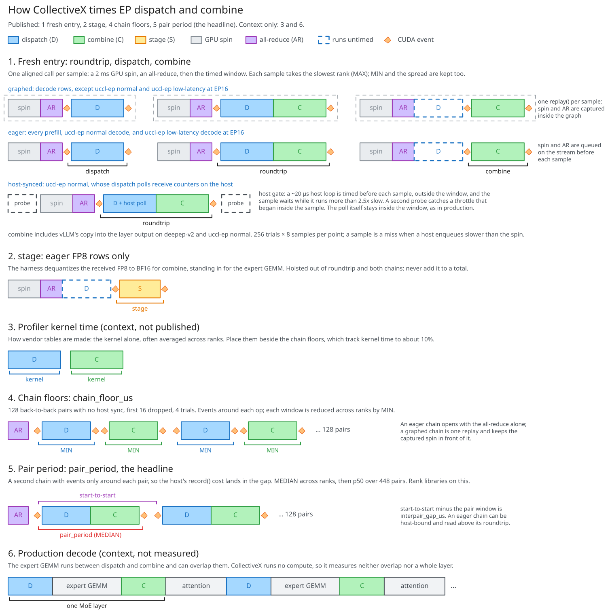
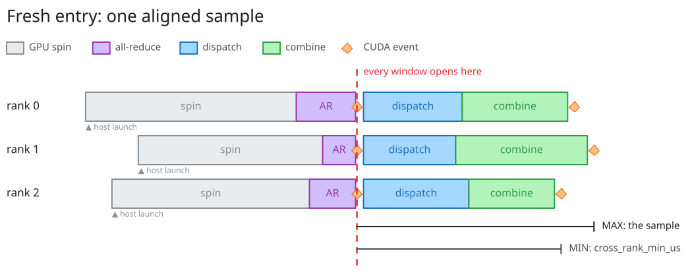
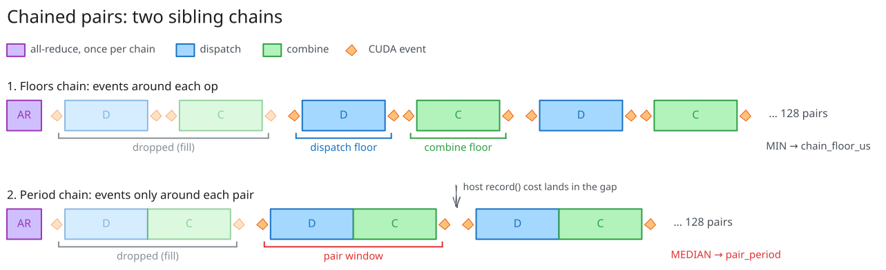

# Summary

What CollectiveX measures, how, and how to read it. The [README](../README.md) holds usage and
coverage. Where the docs and `collectivex/bench/` disagree, the code is authoritative.

CollectiveX times one MoE layer's expert-parallel communication on real allocations: **dispatch**
sends each token to the ranks owning its top-k experts, and **combine** brings the expert outputs
back. No expert compute runs, so it measures neither overlap nor serving throughput, and it does not
rank or recommend.

- **Shape** `deepseek-v4-pro`: hidden 7168, top-k 6, 384 experts, packed placement, uniform
  deterministic routing, proven identical on every rank.
- **`T` is tokens per rank**: decode 1-512, prefill 1024-8192, powers of two.
- **Precision**: dispatch BF16, or FP8 (per-128-block e4m3, FP32 scales) where the backend supports
  it upstream; combine always BF16.
- **Scale**: EP8 is one 8-GPU node (2x4 MNNVL on GB200/GB300); EP16 is 2x8 over RDMA, or 4x4 MNNVL
  on GB200/GB300.
- **Backends** run the configuration their reference engine selects. `production` rows are
  configurations an engine can select today; `candidate` rows describe the library only.

| Backend | Maturity | Launch | Engine contract |
|---|---|---|---|
| deepep-v2 | production | graph; normal prefill eager | vLLM `deepep_v2` and `deepep_low_latency` (MNNVL opt-in on GB pools); LL stops at T=256 |
| nccl-ep | production for LL rank-major BF16; library otherwise | graph decode; prefill eager | TensorRT-LLM `NcclEP` with NVIDIA/TensorRT-LLM#20631 |
| uccl-ep | candidate | normal eager; LL graph at EP8, eager at EP16 | vLLM's DeepEP configuration on UCCL's drop-in `deep_ep` |
| mori | production | graph decode; eager prefill | vLLM's MoRI IntraNode / InterNodeV1, LL EP16 only |
| flashinfer-ep | production | graph decode; eager prefill | vLLM's integration; EP8 on one node, EP8 and EP16 on GB200/GB300 |

**Reading results**

- Rank on `pair_period` p50, the chained steady-state period. Each case is one run, so a small gap
  is no result.
- Fresh-entry p90/p95/p99 are withheld once missed samples reach 10/5/1%. Do not rank multi-node
  decode on fresh-entry p99.
- Graphed and eager rows carry different `kernel_generation` suffixes and never pool.
- Bandwidth is logical wire payload over latency, never link utilization.
- FP8 `stage` is excluded from `roundtrip` and `pair_period`; do not add it back.
- EFA pools (b300, h100) run EP16 through a CPU proxy, so those rows measure the proxy.
- Vendor tables time kernels in a profiler; compare them with `cross_rank_min_us` or
  `chain_floor_us`.
- Limits: no compute between ops, uniform routing, no L2 flush, unlocked clocks (`slow_gpu` flags
  outliers), interior chain pairs unvalidated.

# Methodology

Each case writes one result document into `collectivex/results/`. Uploading those files to the
CollectiveX database publishes them; they are not committed.

## Matrix

Each backend/topology runs one pinned configuration. Token ladders live in `configs/sweep.json`.
`normal` runs both ladders; `low-latency` runs the decode ladder (nccl-ep's also runs prefill,
`backend_mode_phases`) and is enabled per cell by the registry's `ll_backends` map.

`sweep_matrix.py` turns the requested SKUs, backends, EP sizes, modes, precisions and ladders into
shards of one allocation each; a filter shrinks the matrix without changing the contract.
`results/cases.json` is the committed snapshot of the full matrix, and a unit test fails when it
drifts from the configs. A cell whose backend runs on that SKU only at another EP size is listed as
`unsupported`. Success is decided only by the benchmark's return code.

### Ladder Clamps

`workload.ladder_measured`, `ladder_dropped` and `ladder_cap` record what ran. DeepEP V2, UCCL-EP and
MoRI allocate their low-latency receive at 256 tokens per rank (vLLM's batched-DP budget), so those
ladders stop at 256. NCCL EP sizes its group to the ladder's top and runs every rung.

### Unmeasured Cases

Eleven registered EP cases have no published result:

- **h100-dgxc EP16 prefill, deepep-v2 `normal` and nccl-ep `low-latency`** (four cases): they do not
  finish through the EFA proxy inside `COLLX_RUN_TIMEOUT`.
- **mi355x mori EP16** (six cases): two-node MoRI does not start on the vLLM v0.32.0 ROCm image until
  the hosts' AINIC user space matches the image's.
- **mi325x uccl-ep `low-latency` EP16 FP8**: UCCL stalls before the first measurement
  ([uccl-project/uccl#1111](https://github.com/uccl-project/uccl/issues/1111)); BF16 runs.

### Precision

Combine is always BF16. Dispatch is a BF16 control plus, where FP8 dispatch is supported upstream, an
FP8 dispatch (`BACKEND_PRECISIONS` in `sweep_matrix.py`). Every FP8 codec is per-128-block e4m3 with
FP32 scales: 7168 value bytes plus 224 scale bytes per copy.

- **MoRI** quantizes as vLLM's MoRI `prepare()` does (aiter `per_1x128`): e4m3fnuz on gfx942, e4m3fn
  on gfx950. **UCCL-EP** uses e4m3fnuz on gfx942 and e4m3fn elsewhere.
- **Blackwell low-latency** (DeepEP, UCCL-EP) rounds scales to powers of two and hands the receiver
  packed UE8M0 exponents, as vLLM asks; rows carry `-ue8m0`.
- **`normal`-mode codecs** keep unrounded FP32 scales where vLLM rounds them: timing-neutral, not
  bit-identical.
- **NCCL EP** uses its internal DS_FP8E3M4 recipe in low-latency only, as a library row (TensorRT-LLM
  sends DeepSeek-FP8 activations in BF16).

The caller-side quantize is **inside the measured dispatch**, since a forward pass pays it. An FP8
`normal` dispatch therefore covers quantize plus transport and its BF16 control transport alone;
compare the two at the top of the ladder, where the halved payload repays the quantize launch.

`implementation.fp8_consume` is `native` by default: the expert GEMM consumes FP8 directly, as vLLM
and SGLang do. `CX_FP8_CONSUME=dequant` stages every pair from its own dispatch, as vLLM's
quant-format mismatch fallback does. It is a verification hatch, not a second metric
(`dequant roundtrip ~= roundtrip + stage`).

## Backends

Each backend runs the configuration its reference engine selects: vLLM, except TensorRT-LLM for NCCL
EP low-latency ([nccl-ep.md](nccl-ep.md)). Backend source pins live in `runtime/common.sh` and are
enforced by exact fetched-commit comparison; each adapter's import probe rejects any other build.

### DeepEP V2

The `ElasticBuffer` of [DeepEP #605](https://github.com/deepseek-ai/DeepEP/pull/605), pinned to
upstream `main`. The adapter fails closed unless the loaded `deep_ep` exposes `ElasticBuffer`.

- **`normal`** runs vLLM's `deepep_v2` configuration (`library_config.engine_contract = "vllm"`):
  `do_cpu_sync=False`, `do_expand=False`, receive bounded at the next power of two of T,
  `prefer_overlap_with_compute=False` (64 SMs), `allow_multiple_reduction=False`. No dispatch waits
  on the host. `combine` includes vLLM's finalize copy into the layer output
  (`library_config.finalize_copy`).
- **Scale-up** requires an NCCL Device API LSA team covering the whole EP world, which also matches
  vLLM's hybrid autoselect. x86 EP16 is hybrid (GIN across two scale-up domains of eight), with 33
  GIN QPs per peer to fit CX-7's QP budget; GB EP16 stays inside MNNVL on LSA. Where `ibstat` cannot
  see the scale-out rate, the registry's `network.rdma_gbs` sets the SM model
  (`library_config.sm_model_rdma_gbs`).
- **`low-latency`** drives the legacy `deep_ep.Buffer` IBGDA kernels as vLLM's `deepep_low_latency`
  does: per-expert padded receive, gate weights applied in combine, send kernel plus receive hook.
  Multi-node EP16 rides NVSHMEM IBGDA (needs gdrdrv); GB EP16 stays in MNNVL. B300 registers none
  (NVSHMEM aborts on EFA), and H100 registers EP8 only.
- **b300** builds [AWS's EFA fork](https://github.com/amazon-contributing/DeepEP) against NCCL
  2.32.3, since upstream assumes in-order scale-out writes that EFA lacks. Rows carry `-aws-efa-fork`
  and record `deepep_source` and `hybrid_kernel`.
- **h200-dgxc** opts into `rdma_relaxed_ordering`: ElasticBuffer's strict-ordered GIN window caps
  GPU-NIC writes near 10 GB/s in the KVM guests. The patch removes that cap, but upstream chose strict
  ordering on purpose (DeepEP #661/#674), and a passing oracle does not rule out the race. Rows carry
  `-relaxed-ordering`.

### UCCL-EP

[UCCL](https://github.com/uccl-project/uccl) EP is an API-identical DeepEP replacement whose scale-out
runs over CPU proxies issuing GPUDirect RDMA; scale-up is single-node `cudaIpc`, never MNNVL. No engine
ships a selector, so rows are `candidate`, but the adapter runs vLLM's DeepEP configuration on it.
Built from source with `USE_DMABUF=1 PER_EXPERT_BATCHING=1` (`implementation.library_version`).

- **`normal`** is vLLM's `deepep_ht` path (20 SMs, per-call dispatch/combine configs). Its dispatch
  polls the host before launching, so it stays eager and passes the host gate
  ([Rank Alignment](#rank-alignment)). Its pair period therefore runs above its roundtrip at small T
  (by up to 95 µs BF16 and 230 µs FP8).
- **`low-latency`** issues DeepEP V2's calls with vLLM's 256-token receive.
- **AMD builds** use pinned host memory for managed allocations, a plain launch instead of
  `cudaLaunchKernelEx`, and UCCL's aggressive-atomic and inflight-byte settings; `library_config`
  does not record these.
- **h200-dgxc EP16** uses a 1040-token RDMA receive ring (`network.uccl_rdma_recv_tokens`), because
  vLLM's config deadlocks BF16 prefill
  ([uccl-project/uccl#1110](https://github.com/uccl-project/uccl/issues/1110)). Rows carry
  `-rdmarecv1040` and are library rows until UCCL is fixed.
- mi355x EP16 is not registered: it runs about 13x under UCCL's documented bandwidth.

### MoRI

`normal` runs vLLM's `MoriAll2AllManager` under MANUAL launch mode: IntraNode on one node (block_num
80, rdma_block_num 0, 16 warps), InterNodeV1 on two (64/32/8 on gfx950, 32/16/16 on gfx942), one QP
per PE, external input buffer. The adapter fails closed if the realized tuple
(`library_config`) differs. These are the engine-integrated tuples, not MoRI's peak tables.

EP16 requires the STATIC_HEAP symmetric heap (`VMM_HEAP` corrupts cross-node combine on ROCm 7.2,
ROCm/mori#610). `low-latency` follows vLLM's `mori_low_latency`, which differs only across nodes
(`InterNodeV1LL`), so MoRI has no EP8 low-latency cell. `MORI_ENABLE_SDMA` stays unset; rows run
with it carry `-sdma`.

### NCCL EP

NVIDIA's MoE dispatch/combine on the NCCL Device API (`nccl-extensions` wheel); [nccl-ep.md](nccl-ep.md)
has the full contract. EP8 and EP16 run on all six NVIDIA SKUs.

- **`normal`** selects `HIGH_THROUGHPUT` (`candidate`). Its timed dispatch includes
  `ncclEpUpdateHandle`, sized by handle capacity rather than T; NVIDIA's `ep_bench` excludes it.
- **`low-latency`** runs TensorRT-LLM's `NcclEP`: rank-major receive, caller-side weighted
  pre-reduction, unweighted rank-sum combine, one group sized to the ladder's top. Dispatch writes a
  registered window directly within one LSA/MNNVL domain and stages across nodes.

### FlashInfer EP

TensorRT-LLM's one-sided MNNVL `MoeAlltoAll` from FlashInfer 0.7.1 (vLLM's pin): every rank writes into
its peers' workspaces, so all ranks share one NVLink domain (EP8 on one node, EP8 and EP16 on
GB200/GB300). `normal` only, on both ladders, through vLLM's `flashinfer_nvlink_one_sided`
integration, so the staging copy into the workspace is timed inside `combine`. FP8 dispatch carries
DeepSeek blockwise scales as a fourth payload.

## Workload Identity

One deterministic workload is generated over the global token batch from the seed and sliced by
source rank. A keyed BLAKE2b counter gives byte-identical expert indices and gate weights on every
runtime, and the routing trace must match across ranks before a case can succeed. Adapters may not
generate routing.

## Measurement

Every window is a pair of CUDA events. `roundtrip` is dispatch then combine. Expert-output staging is
outside it and is reported as `stage` where it does device work. Under FP8, `stage` converts the
received payload to BF16 in place of the expert GEMM; each adapter converts a different amount, so do
not compare or sum it. `isolated_sum` is isolated dispatch plus combine, never `stage`.

The diagram ([source](img/ep-timing-methodologies.excalidraw)) shows the published windows:

1. **Fresh entry** (`roundtrip`, `dispatch`, `combine`): one aligned call per sample, reduced across
   ranks by MAX (a layer finishes with its slowest rank). `combine` runs behind an untimed dispatch.
2. **Stage**: eager FP8 rows only.
3. **Chain floors** (`chain_floor_us`): events around each op, MIN across ranks.
4. **Pair period** (`pair_period`), the headline: events around each pair, MEDIAN across ranks.

Every row also carries `cross_rank_min_us` and `cross_rank_spread_us`. Read MAX and MIN as a bracket:
two cells whose MAX gap is smaller than the larger spread are not separated. Isolated `dispatch` and
`combine` inherit the preceding op's exit stagger, so treat them as diagnostics.

### CUDA Graph Replay

Engines capture decode, so graph-compatible decode pairs replay CUDA graphs; prefill stays eager
everywhere, and `COLLX_CUDA_GRAPH=0` forces eager. Graphed: deepep-v2 (both modes), nccl-ep (both
modes; HT runs NCCL graph usage mode 1, `-gum1`), mori (both modes), flashinfer-ep, and uccl-ep
low-latency intranode only.

Only the launch changes. Each fresh-entry component captures one pair with the alignment ahead of its
first event; each chain sibling is one graph of 128 pairs. Capture uses torch's `global` error mode,
so a capture-unsafe call fails. Rows carry `-cudagraph-spin-ar` or `-eager-spin-ar`.

### Rank Alignment

Each fresh-entry sample opens as DeepEP's `bench_kineto` does: a 2 ms GPU spin
(`COLLX_ALIGN_SPIN_US`, recalibrated after warm-up) and then a device all-reduce, with no host sync.
The spin outlasts the host's enqueue, so every rank's timed work is queued when the all-reduce
releases them, and entry skew and launch latency stay outside the window.

A sample is **missed** when a rank's host took longer than the spin to enqueue its work (eager) or
return from its replay (graphed). Garbage collection is off while timing. Rows publish
`rank_alignment.missed_samples` and `missed_fraction`, and tails are withheld once missed or
host-stalled samples could fill them: p99 at 1%, p95 at 5%, p90 at 10%.

**Host-synced series** (uccl-ep `normal`) keep the host's poll inside the window, its production
cost. Some hosts throttle under busy-polling proxies, so each sample first runs a short host probe
outside the window and waits while the host runs over 2.5x slow, then probes again after the sample.
Rows publish `host_held_samples` and `host_stalled_samples` (which gate tails like missed samples);
these are null where dispatch does not wait on the host. Eager chain siblings pass the same gate and
restart together, up to three times (`chain_health.host_retried_siblings`, `host_stalled_trials`).

### Chained Pair Period

A decode loop pays the pipeline's steady-state **period** per MoE layer. `benchmark_chain` issues
dispatch→combine pairs back to back with no host sync, drops the first 16 as fill, and pools 4
trials.

Each trial runs two sibling chains of 128 pairs, so one chain's event-recording cost does not enter
the other's numbers: the **floors chain** records only op windows, the **period chain** only pair
windows.

- `components.pair_period` (`chained-median`): pair windows reduced by MEDIAN, since collectives
  phase-lock the ranks into one cadence and a MAX would publish whichever rank hiccuped.
- `chain_floor_us.dispatch` / `.combine` (`chained-cross-rank-min`): op windows reduced by MIN,
  within ~10% of profiler kernel time. `period - Σfloors` > 0 is per-pair inter-rank wait.
- `chain_health.pair_spread_us`, `interpair_gap_us` and `settle_drift_us` check that the point is a
  steady state.

Chained per-op medians and p99s are never published: without a host sync, each rank's wait lands in
an arbitrary op window, while the period is conserved. The period is always free-running, which every
backend's receive plane tolerates.

An eager chain can be host-bound: on GB200/GB300, deepep-v2 normal FP8 prefill at T=1024 is paced by
the Grace host above its aligned roundtrip. There the aligned `roundtrip` is the transport number.

### Timing Profile

Defined in `configs/sweep.json` and recorded in `measurement.sampling`:

- Fresh entry: 256 trials x 8 iterations = 2048 samples per component, nearest-rank p50/p90/p95/p99
  of the per-sample cross-rank MAX.
- Chained: 4 trials x (128 - 16) = 448 pairs each for the period and the floors.
- 32 warm-ups before each component and chain trial; component order and ladder rotate per trial.
- Every shape gets 8 untimed settling roundtrips and its correctness check before any timing.

### Vendor Tables

Vendor microbenchmarks time the kernel alone through a profiler, replay graphs, average across ranks,
or report the best of a config sweep. Expect this suite's headline to read above them; place
`cross_rank_min_us` and `chain_floor_us` beside such tables.

### Bandwidth

Rows carry bytes and latency; `bandwidth.py` and the dashboard derive
`wire_payload_bytes / measured_latency_seconds`, excluding metadata, padding and buffer capacity.
`byte_provenance` (one copy per unique token and destination rank) is the comparable basis;
`wire_byte_provenance` is what the kernels move (per token and expert for low-latency kernels that
weight in combine), and `logical_copies` says which applies. Bandwidth is never labelled physical.

## Correctness

An implementation-independent oracle with an expert-specific transform, so wrong routing cannot pass
an identity roundtrip, verifies for every rank and point:

1. routing, multiplicity, gate weights and receive counts;
2. dispatched payload, metadata and combined output before and after timing, with inputs unchanged;
3. the chain's final combined output against a drained pair, then the full checks again on the state
   the chain leaves behind;
4. under graph replay, that every capture rewrites its poisoned output and does not replay captured
   data.

Any failure makes the case `invalid` (`correctness.passed`). Interior chain pairs stay unvalidated,
since checking them would put work in the timed loop.

The chain check gates only where the chain stages per pair and reports `null` otherwise, which covers
every FP8 row by default. Run `CX_FP8_CONSUME=dequant` when an FP8 period moves without its BF16
sibling, and before publishing a new FP8 backend. Read `correctness.chain_last_output_error` before
the verdict.

The combine model follows `implementation.combine_reduction`: `domain-fp32` (uccl-ep, MoRI, nccl-ep
HT, FlashInfer) reduces in FP32 per scale-up domain and casts before the scale-out sum; `rank-fp32`
(deepep-v2, nccl-ep low-latency rank-major) sums per destination rank in FP32. The gate is max
relative error (denominator clamped at 0.02) below `8 * 2^-8`. Under FP8 the oracle applies the
backend's exact quantize, so the payload check stays bit-exact.

## Result Document

One document per case, `results/<sku>/<case_id>.json` (`record_type: "case-attempt"`), replaced by
each re-run. Unsupported or never-run cells produce none.

- `identity`: `case_id`, `attempt_ordinal`, `case_factors`, `allocation_factors`.
- `workload`: `cross_rank_consistent`, `ladder_measured`, `ladder_dropped`, `ladder_cap`.
- `measurement`: dtypes, `combine_semantics`, `payload_unit`, `sampling` and per-point `rows`.
- `implementation`: `name`, `kernel_generation`, `maturity`, `fp8_consume`, `rank_alignment`,
  `stage_excluded_from_roundtrip`, `chained_period`, `cuda_graph_supported`, `cuda_graph_replay`,
  `combine_reduction`, `library_version` and `library_config` (SM and QP counts, buffer sizing,
  zero-copy, `engine_contract`).
- `topology`: device, placement, nodes, scale-up domain, world size and transports.
- `runtime`: vendor, torch, CUDA or HIP, NCCL/RCCL and `gpu_clocks`, each rank's SM clock after every
  burst, with `sm_clock_ratio_min` and `slow_gpu` (ratio below 0.95 or 5% of passes throttled).
- `provenance`: image tag, source SHA and `source_dirty` (dirty results are never published).
- `outcome`: `status` (`success` or `invalid`) and `reasons`.

## Identity

`case_id` is `{sku}-{backend}-{workload}-{mode}-{phase}-ep{ep}-{routing}-{precision}`, slug-normalized;
`attempt_ordinal` is `COLLX_ATTEMPT_ID` (default 1). Rows of one backend pool only within one
`implementation.kernel_generation`:

| Backend | Families |
|---|---|
| deepep-v2 | `v2-elastic-buffer-vllm-nosync` (+`-relaxed-ordering`, `-aws-efa-fork`); `legacy-buffer-ll-hook` (+`-ue8m0`) |
| uccl-ep | `uccl-legacy-buffer-vllm-ht`; `uccl-legacy-buffer-ll-hook` (+`-ue8m0`) |
| mori | `intranode-vllm`, `inter-node-v1-vllm`, `inter-node-v1ll-vllm` (+`-sdma`) |
| nccl-ep | `nccl-ep-v02-ht-routed-zc-static`, `nccl-ep-v02-ll-rm`, `nccl-ep-v02-ll-em`, with suffixes in [nccl-ep.md](nccl-ep.md) |
| flashinfer-ep | `flashinfer-mnnvl-one-sided-staged-<wheel version>` |

Every family also ends in `-cudagraph-spin-ar` or `-eager-spin-ar`.

## Execution Isolation

Every non-MNNVL scale-out case needs the registry's `rdma_devices` for its fabric (HCAs are never
guessed) and `socket_ifname` for the socket interface; both must be up and ACTIVE on every node before
backend initialization. Each shard clears inherited NCCL, NVSHMEM, MoRI and UCCL selectors first.

- **IB and RoCE pools** force `NCCL_NET=IB` (a socket fallback fails rather than being labelled RDMA),
  use exact-match device lists, apply `ib_gid_index` only to all-Ethernet ports, and pin
  `NCCL_IB_MERGE_NICS=0` (a fused device disables the GIN DeepEP's hybrid EP16 needs).
  `rdma_service_level`, `rdma_traffic_class` and, on rail-isolated fabrics, `NCCL_CROSS_NIC=0` come
  from the registry's `network` block.
- **EFA pools** (b300, h100-dgxc) bind the host's EFA and aws-ofi-nccl user space into the container,
  select the plugin (`NCCL_NET_PLUGIN=ofi`, `FI_PROVIDER=efa`) and run NCCL GIN on its CPU proxy
  (`NCCL_GIN_TYPE=2`, GDRCopy 2.5+). Shards build aws-ofi-nccl 1.21.1 where the host plugin is older
  or cannot load in the image.
- **Single-slurm pools** (H100, H200, B200, B300) reject an allocation with a GPU in thermal slowdown
  or above 90 °C and retry, up to three allocations.

The repository is staged into a mode-0700 child of the operator's `stage_dir`, visible to the login
and allocated nodes, and removed after teardown. Pinned sources are fetched on the submit host,
because compute nodes may have no network.

## Image Pinning And Build Isolation

Each image tag is imported once per cluster into a squash, refreshed when the registry digest moves
(`COLLX_IMAGE_REFRESH=1` forces it) and validated on each use. Backends the image does not ship are
built at their pins into a mode-0700 cache mounted as `/cx-cache`, keyed by CPU and GPU architecture,
image and pin. DeepEP V2 builds against the image's torch and NCCL, as vLLM does; the b300 EFA fork
carries NCCL 2.32.3 and torch 2.11.0. `runtime.framework` and `runtime.collective_library` record the
pair. A cache that fails its runtime probes is rejected, never reset.

## Result Delivery

Each shard copies its documents to `results/<sku>/` in the checkout that ran it. They reach the
dashboard only through the InferenceX-app upload (`admin:db:ingest:collectivex --dir`), which checks
every file against `results/cases.json` and rejects uncommitted-code results and host-identifying
fields.
