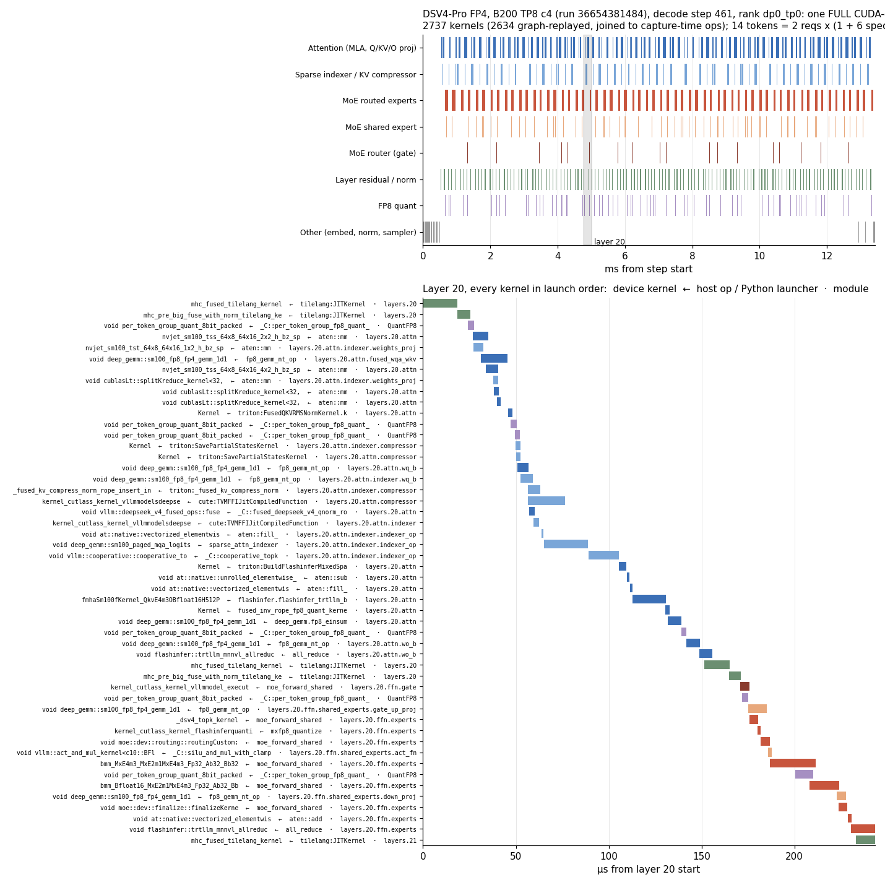
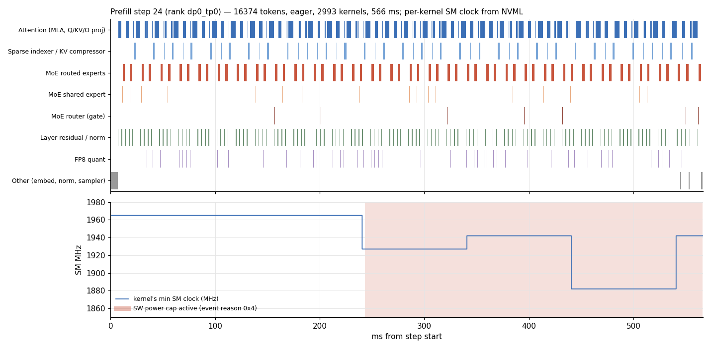

# Op-attributed engine profiles for AgentX points

Profiles a single-node vLLM, SGLang or TRT-LLM srt-slurm AgentX point (for
example `dsv4-fp4-b200-vllm-agentic-mtp`) during its real replay and
attributes every device kernel to the CPU-side call stack that launched it: the
module stack, the torch op, and for kernels launched straight from Python, the
launcher and its engine callers. Kernels replayed from CUDA graphs are
attributed through the graph's capture.

## Layout

- `sitecustomize.py`: loads through the workers' `PYTHONPATH` and boots
  `infx_prof` when `INFX_PROF_DIR` is set.
- `infx_prof/`: the in-engine hooks. The core is engine-neutral:
  - `imports.py`: patch a module when it is imported (or now, if it already is).
  - `steps.py`: the per-step record and `infx_step#k` marker.
  - `windows.py`: profiler windows, and the graph-capture profile.
  - `graphs.py`: CUDA graph ordinals and stream markers.
  - `modules.py`: module markers, eager and Inductor-compiled.
  - `launchers.py`: Python launchers of kernels without a torch op.
  - `routing.py`: per-step MoE top-k ids.
  - `envinfo.py`: versions and device identity per rank.

  `infx_prof/engines/<engine>.py` adapts one engine (`INFX_PROF_ENGINE`):
  where its steps, ranks, graph captures, models and MoE routers are, and
  which kernel packages launch from Python.
- `profile_windows.py`: the window client, run beside the benchmark client;
  `clock_sampler.py` polls GPU clocks for it.
- `synthetic_load.py`: the fixed-shape load of synthetic mode.
- `extract.py`: per-step attribution from a profile artifact.

| | vLLM | SGLang | TRT-LLM |
|---|---|---|---|
| Step | `execute_model` (dummy: `execute_dummy_batch`) | `Scheduler.run_batch` (dummy: an IDLE batch) | `PyExecutor._forward_step` (dummy: only padding requests) |
| Windows | vLLM's profiler, `/start_profile` | `control/windows.jsonl` | `control/windows.jsonl` |
| Graph capture | `capture_model` | every `*CudaGraphRunner.capture` | `PyTorchModelEngine.warmup` |
| Graph mode | the dispatcher's `cg_mode` | the target graph runner that replayed (decode FULL; prefill by its backend) | `CUDAGraphRunner.replay` (FULL), other graph replays (PIECEWISE) |
| MoE routing | the routed-experts `capture_fn` | the ids `FusedMoE.forward_impl` is handed, else recomputed | `routing_method.apply`, else recomputed |

Inside torch.compile (SGLang's piecewise prefill traces the MoE layers) the copy into
the routing buffer is the custom op `infx::capture_routing`, which Dynamo
leaves opaque, so compiled graphs still record routing.

When a router fuses top-k into the MoE kernel (TRT-LLM's TRTLLM-gen backend,
FlashInfer TRT-LLM-gen MoE in SGLang), no ids exist outside the kernel. SGLang
then hands the MoE layer a `BypassedTopKOutput`, and `FusedMoE.forward_impl`
recomputes its ids eagerly with SGLang's own `select_experts`
(`to_standard`). In TRT-LLM, routing methods with a closed form (top-k of the logits, or of
sigmoid plus the correction bias, as MiniMax-M3's) are then recomputed from the
layer's router logits, the same top-k selection on the same inputs, under an
`infx_py#infx_prof.routing.recompute` marker (SGLang's recompute too): those
kernels are the profiler's, not the engine's. Otherwise
`routing/<rank>/meta.json` says routing is unavailable, as it does for SGLang
DP attention with a gathered (not all-to-all) MoE, whose router sees every DP
rank's tokens in a padded layout.

## Running

Dispatch `e2e-tests.yml` on a branch carrying this directory with a `profile`
input (a JSON object; `{}` takes every default):

```sh
gh workflow run e2e-tests.yml -R SemiAnalysisAI/InferenceX --ref <branch> --json <<'EOF'
{
  "ref": "<branch>",
  "agentx-fast": "true",
  "test-name": "profile test",
  "profile": "{}",
  "generate-cli-command": "test-config --config-files configs/nvidia-master.yaml --scenario-type agentic-coding --no-evals --conc 32 --config-keys dsv4-fp4-b200-vllm-agentic-mtp"
}
EOF
```

One concurrency selects one recipe variant (for DSV4 on B200: `tp8_c*` or
`dep8_c*`). Settings (`infx/srt_slurm/single_node.py`, `PROFILE_DEFAULTS`):

| Setting | Default | Meaning |
|---|---|---|
| `windows` | `[["warmup", 0, 32], ["decode", 0, 32]]` | `[anchor, delay_seconds, iterations]` per torch profiler window. `warmup` and `profiling` anchor on aiperf logging that phase's start; AgentX warmup is the lanes' long first turns, all sent at its start (prefill-heavy; at TP8 c4 they have drained by 60 s in). `decode` anchors on steady decode: from the warmup start, the first 20 s in which at least 90% of the engines' logged steps replayed FULL CUDA graphs (falling back to 150 s before the measured replay's cap). Each measured-phase turn re-prefills first, so under data parallelism, where one prefilling rank keeps every rank eager, steady decode arrives late and at a time that depends on concurrency |
| `capture_ranks` | engine default | Workers whose CUDA graph capture is profiled (`"all"` for every rank). By default every rank under SGLang or TRT-LLM attention DP, whose ranks capture different graphs (per-rank buffers change copy kernels), else `"dp0_tp0"`; each rank joins its own capture when profiled |
| `host_headroom_gib` | `128` | Host memory taken from a CPU KV tier for the profiler's buffers: vLLM's SimpleCPUOffload pool or embedded Mooncake store (`global_segment_size`), SGLang's HiCache `hicache-size`, TRT-LLM's `kv_cache_config.host_cache_size`. A HiCache pool sized by `hicache-ratio` (a multiple of the GPU KV pool) is left as is |
| `duration` | last `profiling` delay + 600 s | Cap on the measured replay. Once its last window closes (and the measured phase has run 60 s), the window client SIGINTs aiperf, which exports what it measured and exits zero, so the run does not replay past its windows |
| `mode` | `"agentic"` | `"agentic"` replays AgentX; `"synthetic"` drives fixed shapes (`synthetic_load.py`): CONC random-token prompts of `isl` tokens with one-token outputs while the prefill window is open, then `osl`-token generations until the decode window closes. No trace dataset or AgentX warmup: a point takes minutes after engine start-up |
| `isl`, `osl` | `8192`, `4096` | Synthetic prompt and output lengths. `isl` stands in for the KV context: decode steps attend over `isl` plus the tokens generated so far |

A profiled point holds its node for 30 to 60 minutes on B200 (engine start-up
and graph capture, then an AgentX warmup that grows with concurrency). Its
throughput is not a result: windows pause the engine while they export, and
profiled runs tolerate failed requests.

At DSV4 DEP8 c192 on B200, a warmup window has preceded an engine fault in two
of three runs (`CUBLAS_STATUS_EXECUTION_FAILED` in the attention compressor's
`torch.mm`, when warmup's cache-pressure requests arrive, minutes after the
window closed); the same point without it (`{"windows": [["decode", 0, 32]]}`)
and unprofiled production runs complete. Profile such a point's prefill
(`{"windows": [["warmup", 0, 32]]}`) and decode in separate runs.

Deviations from the recipe, all recorded in the run's config: the hooks'
environment, compile caches off (compiled code gets its module markers when
Inductor generates it), longer engine timeouts (a window's export pauses its
rank), CPU KV tiers smaller by `host_headroom_gib`, and per engine:

- vLLM: its torch profiler config.
- SGLang: `watchdog-timeout` and `dist-timeout` of at least 1800 s.
- TRT-LLM: none beyond the above.

## Example

DSV4-Pro FP4 on B200, TP8 c4. A decode step: one FULL CUDA-graph replay,
every kernel joined to the op, launcher and module that launched it:



A prefill step with each kernel's SM clock; the SW power cap engages and the
clock steps on NVML's ~100 ms grid:



## Artifacts

- `profile_<result>`: `infx-profile.tar`, the full record.
  - `torch/`: the engine's per-rank traces, one per window.
  - `capture/`: the CUDA graph capture traces, one per capture session, with
    module and launcher markers (no Python stacks: over every captured size
    their export outlasts start-up).
  - `steps/<rank>.jsonl`: every step's batch composition on that rank.
  - `copies/<rank>.jsonl`: every CPU KV-offload block copy the rank queued
    (direction, blocks, bytes, step, vLLM callers; vLLM's CPU offload only).
  - `routing/<rank>/step<k>.npz`, `routing/<rank>/meta.json`: each profiled
    step's MoE routing: `counts` (tokens per expert per layer, int32
    `[layers, experts]`), `tokens`, `t0_ns`, and `ids` (each token's top-k
    expert ids per layer, int16 `[tokens, layers, topk]`, -1 for none) when
    the step has at most 1024 tokens. `meta.json` maps layer ids to module
    names and lists layers the capture could not bind.
  - `clocks/window<w>.csv`, `clocks/gpus.json`: every GPU's graphics, SM,
    memory and video clocks and clock event reasons, polled through NVML every
    250 us per GPU for the length of each window, each poll stamped when it
    began and returned (`clock_sampler.py`); every 4th poll also reads power
    (`power_mw`, and on AMD the cumulative energy accumulator `energy_mj`), -1
    on the others. `gpus.json` records each GPU's power and energy source.
  - `clocks/power<w>.csv` (NVIDIA): the driver's power samples
    (`t_ns,gpu,sample_mw,<mW>`, stamped by the driver) and the energy counter
    read at the window's start and stop (`energy_mj`).
  - `clocks/rates.json`: each telemetry source's measured update period and
    read cost on GPU 0 (`rate_probe.py`).
  - `clocks/telemetry<w>.csv`, `clocks/telemetry.json` (with
    `INFX_PROF_TELEMETRY=1`): every other reading the GPUs and host expose,
    one row per change of value
    (`t0_ns,t1_ns,device,source,scope,stamp_us,value`; `telemetry.py`), and
    each GPU's clock limits and the fields it answered.
  - `graphs/`, `env/`, `profiler/`, `control/`, `windows_conc<c>.jsonl`:
    graph ordinals, versions and config per rank, each rank's window
    start/stop, window requests, and the window client's log.
- `profile_steps_<result>`: the same profile broken down by step
  (`extract.py`).
  - `index.json`: every step file with its kernel count, device span,
    tokens, request count, phase, CUDA graph mode, `energy_j` and
    `avg_power_w`; `power_schema` is 1 when the profile has power readings
    (null for profiles from before them).
  - `report.json`: per-trace attribution coverage, graph joins, the
    kernel-name check, `rate_probe` (`clocks/rates.json`), and
    `telemetry_rates`: for each telemetry reading, the p10/p50/p90 spacing of
    its changes (`change_ms`) and of its source timestamps (`stamp_ms`),
    pooled over GPUs.
  - `window<w>/<rank>/step<k>.json.gz` (`dummy<k>` for an idle DP rank's
    forward, `unstepped` for kernels outside any step):

    ```
    {"rank", "window", "kind", "step",
     "summary": {"kernels", "busy_us", "t0_us", "t1_us", "span_us", "sources"},
     "power":   {"polls", "sm_mhz": {"min", "avg", "max", "samples"},
                 "power_w": {"min", "avg", "max", "samples"},
                 "event_reasons": {"<bit, hex>": fraction of polls with it set},
                 "energy": {"j", "avg_power_w", "source": "power_samples" | "energy_counter",
                            "update_period_ms", "below_resolution"}},
     "batch":   {"phase", "graph", "total_tokens",
                 "reqs": [{"req", "scheduled", "computed", "spec", "new", "prompt_len"}], ...},
     "routing": {"source_rank", "tokens", "topk", "num_experts", "has_ids", "file",
                 "expert_tokens": {"<MoE module>": [[expert, tokens], ...]}},
     "kernels": [{"kernel", "cat", "stream", "device", "ts_us", "dur_us",
                  "source": "eager" | "graph" | "offload_copy" | "unattributed",
                  "module_stack": [[qualified name, [[shape, dtype], ...]], ...],
                  "op", "op_chain", "input_dims", "input_types", "concrete_inputs",
                  "launcher", "launcher_callers", "annotations",
                  "graph", "node_pos", "graph_node_id", "grid", "block",
                  "dur_us_recorded",  # a copy's recorded duration, when dur_us was bounded (below)
                  "copy": {"store", "blocks", "bytes", "issue_lag_us"},
                  "profiler": true,  # the profiler's own work (routing snapshot copies, recomputed routing)
                  "clocks": {"graphics_mhz": [min, max], "sm_mhz": [min, max],
                             "mem_mhz": [min, max], "video_mhz": [min, max],
                             "event_reasons", "samples", "prior_us",
                             "power_w": [min, max], "power_samples", "power_nearest_us"}, ...}]}
    ```

## How attribution works

`sitecustomize.py` loads through `PYTHONPATH` and does nothing unless
`INFX_PROF_DIR` is set. Its markers are `record_function` ranges emitted only
while a profiler runs:

- `infx_step#k` / `infx_dummy#k`: a scheduled step and an idle DP rank's
  dummy forward. Each step's batch composition is logged under the same `k`.
- `infx_mod#<qualified name>#<dims>:<dtype>;...` (e.g. `7x7168:bfloat16`): every
  module call and its tensor inputs, through global module hooks registered
  only while a window or capture is profiled (they do nothing while Dynamo
  traces). Inductor-compiled code marks the module of each scheduler node it
  generated, and engine ops that take a `layer_name` mark that layer.
- `infx_py#<launcher>#<engine frame>|...`: the Python entry points that launch
  kernels without a torch op (Triton, TileLang, CuTe DSL, and the engine's
  kernel packages: DeepGEMM, FlashInfer, sgl-kernel, ...).
- `infx_graph_capture#n` / `infx_graph_replay#n`: CUDA graph ordinals.

Marker names carry no quotes or backslashes: Kineto writes event names into the
trace JSON unescaped, and the extractor fails on a trace it cannot decode.

An eager kernel joins its CPU launch through the launch id CUPTI records on both. A kernel
replayed from graph `n` carries a `graph node id`: ordered by node id, graph
`n`'s nodes pair with the launches recorded while graph `n` was captured,
which carry that launch's full context. `report.json` counts a graph whose
node count differs from its captured launches as `count_mismatch`, and lists
graph kernels whose op never launched that kernel eagerly.

HIP graph replays carry no node id. Each replay stream runs its nodes in
capture order, so capture order is an interleaving of the per-stream sequences.
A beam search over the streams' heads picks the interleaving that best matches
each launch: a kernel family (name without template arguments) its op or
launcher ran eagerly, its Inductor or Triton kernel, and a memset or memcpy only
where one was captured; ties go to device start order. On MI355X DSV4 it finds
the exact optimum on every two-stream graph and orders the three-stream decode
graph with no kernel/copy mismatches (device order alone has 112).
`report.json` counts the positions that had name evidence as
`stream_order_evidence` of `stream_order_positions` (~70% on MI355X DSV4
decode); positions without evidence follow device order.

CPU KV offload (SimpleCPUOffloadConnector) copies blocks with
`cuMemcpyBatchAsync` from the connector's copy thread. Kineto records neither
that driver call nor `record_function` ranges on that thread, so those memcpys
have no CPU launch. Each queued copy is one memcpy on its direction's stream,
run in queue order, and `copies/` logs each one as it is queued. Per direction,
the extractor pairs the memcpys in order with the logged copies issued before
them (with equal bytes), taking the pairing with the least total issue lag.
The step markers put the log's wall clock on the trace clock.

On AMD the sampler reads `amdsmi`'s gpu_metrics instead of NVML: the graphics
clock fills both `graphics_mhz` and `sm_mhz`, and `event_reasons` holds the
gpu_metrics throttle status (AMD's bit meanings, not NVML's). `gpus.json`
records which metrics fields were read; ranks join to GPUs by UUID or PCI
address.

A kernel's `clocks` are its GPU's polls over its lifetime: the last poll that
returned before it started (`prior_us` earlier) and every poll overlapping it
(`samples`), as each clock's min and max and the OR of the event-reason
bitmasks (NVML `nvmlClocksEventReason*`). The window client, not the engine,
polls NVML, one thread per GPU, from just before each window opens until every
engine that started profiling has stopped (`profiler/<rank>.jsonl`, logged by
the patch) plus twice the window's longest step, as the GPU trails the engine;
the env record's GPU UUID ties a rank to its polls. On B200 an NVML poll occasionally blocks for 10 to 55 ms, more often
under prefill load; a reading is from somewhere inside its poll, and a kernel
within such a poll shows it as a large `prior_us`.
`report.json` gives each trace's clock coverage and `prior_us` percentiles.

On NVIDIA, power and energy come from the driver's power samples
(`nvmlDeviceGetSamples(NVML_TOTAL_POWER_SAMPLES)`): every ~20 ms on B200 and
GB200, stamped by the driver in CPU time (us since 1970, the wall clock the
step log uses), drained by a second thread per GPU every 0.5 s. The NVML
power readings (`NVML_FI_DEV_POWER_INSTANT`, `nvmlDeviceGetPowerUsage`)
refresh only every ~100 ms there; the polls keep them in `power_mw`. The
energy counter (`nvmlDeviceGetTotalEnergyConsumption`) also updates every
~100 ms and takes ~4 ms to read, which stalled the clock polls when they read
it, so it is read only when a window starts and stops; `report.json`'s
`energy_check` puts each window's counter delta beside the samples' integral
over the same interval. On AMD, power and energy come from the polls'
gpu_metrics read: socket power (averaged by the SMU) and the energy
accumulator scaled by amdsmi's counter resolution, both refreshed with the
table every ~2.5 ms on MI355X. `clocks/rates.json` has each part's measured
periods.

A kernel's `power_w` is the readings stamped during it (`power_samples`);
with none, the nearest reading, `power_nearest_us` away. Most kernels are
shorter than the update period, so their reading reflects the GPU around
them, not the kernel alone. A step's `energy` integrates the power samples
(linear between them) from its first kernel start to its last kernel end
(`source: power_samples`), or on AMD interpolates the energy accumulator
between its updates (`energy_counter`); `update_period_ms` is the median
spacing of those readings, and a step shorter than it is `below_resolution`:
its joules are an interpolated share, not a measurement. `event_reasons` per
step is the fraction of polls with each bit set (NVML or AMD bit meanings, by
backend).

A stream runs an eager copy or memset before its next work, so an eager
memcpy or memset whose recorded end lies past the start of the next activity
on its stream has `dur_us` bounded at that start and the recorded value kept
as `dur_us_recorded`. ROCm records some host-to-device copies ending seconds
late (MI355X Qwen3.5: 26 copies of 64 KB recorded at up to 6.5 s, with
thousands of the same stream's kernels inside). Kernels are not bounded:
programmatic dependent launch and graph branches overlap legitimately.

`rate_probe.py` runs once per profile, after the last window while the load
still runs: on GPU 0 it reads each source alone in a tight loop for 1 s
(clocks, event reasons, power and energy by every API, temperatures,
perf-policy, PCIe and NVLink counters) and records the read cost and the
spacing of value changes, and drains each driver sample buffer for 2 s and
records its timestamps' spacing. `INFX_PROF_RATE_PROBE=0` skips it.

`telemetry.py` (off unless `INFX_PROF_TELEMETRY=1`: on B200 its batched field
reads held the device long enough to age the clock readings kernels are
joined to from a 158 us to a 3.8 ms median) reads the rest, each source on
its own thread per device, and writes a row only when a reading changes:

- NVIDIA, every ~1 ms: one batched `nvmlDeviceGetFieldValues` (instant,
  1 s-average and module power, energy, power limits, memory temperature and
  T.Limit thresholds, perf-policy counters, which accumulate the time spent
  throttled per policy, PCIe bytes, and NVLink data bytes per link), GPU die
  and hottest-point temperature, P-state, fan and utilization. `stamp_us` is
  NVML's timestamp for the value.
- NVIDIA, every 250 ms: the driver's `nvmlDeviceGetSamples` buffers (total and
  module power, GPU and memory utilization, SM and memory clock), every sample
  kept with its driver timestamp. Both timestamps are CPU time in us since
  1970, the wall clock the step log and the polls use.
- AMD, every ~1 ms: every numeric gpu_metrics entry, list entries by index
  (`scope`); `firmware_timestamp` changes on each table refresh.
- Host, every 5 ms: RAPL energy counters and hwmon power sensors (Grace and
  ACPI power meters) where readable, and min/mean/max CPU frequency every
  100 ms.

A reading that moves under load changes on every update, so its row spacing
in a window is its update period, to within the ~1 ms read interval;
`report.json`'s `telemetry_rates` gives that spacing per reading. A reading
that moves slowly, such as a temperature, changes less often than it updates.

MoE routing is dynamic, so each step records what its router chose. The
engine adapter hands every MoE layer's top-k expert ids (target model, not the
draft) to the core capturer, before CUDA graph capture; in vLLM through the
routed-experts `capture_fn`. It copies the ids into a device buffer, a GPU copy
that graphs capture and replay.
Inside a window, every step's rows are copied to pinned host memory
asynchronously (`infx_routing_copy`) and written at the window's stop. The ids
are logical expert ids before EPLB remapping, for this DP rank's tokens; TP
ranks route the same tokens, so TP rank 0 writes for its group. A step file's
`routing.expert_tokens` is keyed by the MoE module name, which joins to the
`module_stack` of that layer's MoE kernels. The capture adds one small copy
kernel per MoE layer per step to every profiled run.
