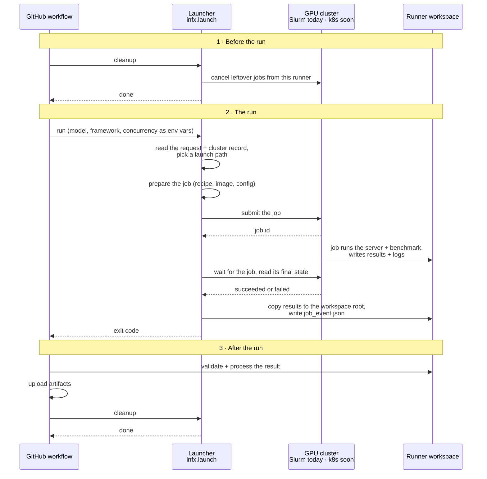
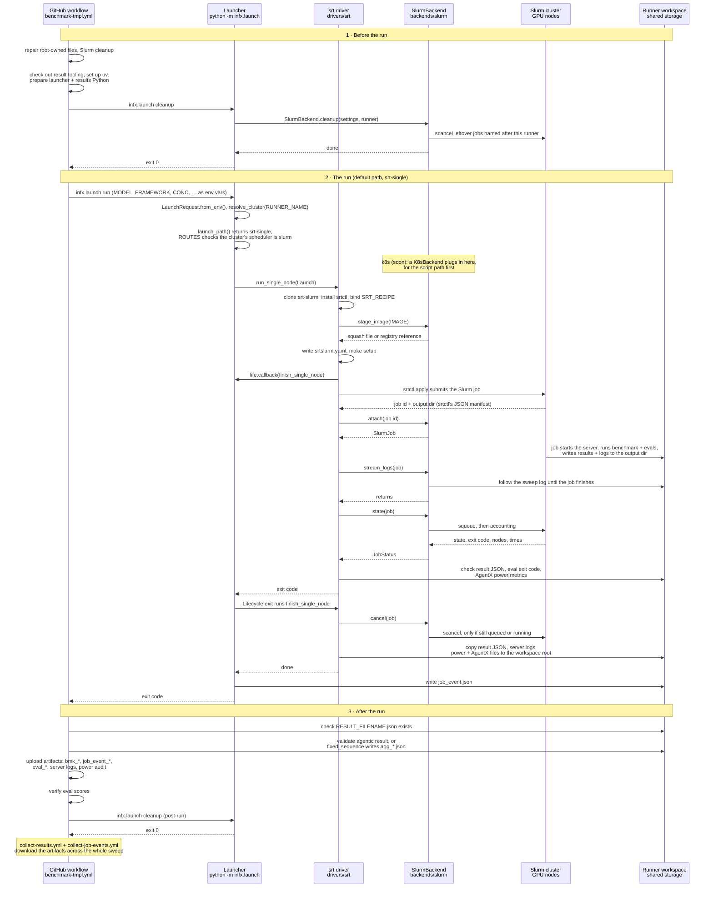

# How a benchmark point runs

Each benchmark point runs as one GitHub Actions job on a runner that sits on a GPU
cluster. The workflow ([`benchmark-tmpl.yml`](../../.github/workflows/benchmark-tmpl.yml)
and its siblings) calls the launcher, [`infx/launch`](../infx/launch), which turns the
point's environment variables into one GPU job and leaves the results, logs and a
`job_event.json` record in the runner workspace. The launcher never uploads anything;
the workflow's later steps do.

## Overview

If the run fails or is cancelled, the launcher still cancels the GPU job and writes
`job_event.json`.

## Two ideas

- A **driver** decides what runs. The `srt` driver hands a recipe to srt-slurm's
  `srtctl`, which starts the inference server and runs the benchmark. The `script`
  driver runs one bash benchmark script in one container.
- A **backend** decides how jobs run on a cluster: it stages images, starts
  containers, follows logs and job state, and returns outputs. The cluster record's
  `scheduler:` field in [`configs/runners.yaml`](../configs/runners.yaml) selects it.
  Slurm is the only backend today.

## Choosing a launch path

`policy.launch_path()` checks these rules in order; the first match wins.
`drivers.ROUTES` maps each path to its driver.

| # | If the point… | Path | Driver |
|---|---|---|---|
| 1 | is a `video-generation` scenario | `srt-video` | srt |
| 2 | is multinode and on a `NATIVE_SRT_LANES` row | `srt-native` | srt |
| 2 | is any other multinode point | `srt-multi` | srt |
| 3 | is on a `BATCH_WRAPPED_LANES` row | `srt-batch` | srt |
| 4 | sets `BENCH_SCRIPT_OVERRIDE` | `script` | script |
| 5 | matches none of the above | `srt-single` | srt |

The srt paths require `scheduler: slurm` and fail before any work on another cluster.
The script path uses only the generic backend interface, so it runs on any scheduler.

## One point in detail

This follows the default path, `srt-single`. Solid arrows are calls and dashed arrows
are their returns.

Results reach the workspace root in `finish_single_node`, the cleanup the driver
registers before it submits. `Lifecycle` runs registered cleanups in reverse order on
every exit path, including a signal, so a cancelled job still returns its logs.

The other paths keep phases 1 and 3 and change the middle of phase 2:

| Path | What differs |
|---|---|
| `script` | No srtctl. The driver calls `prepare_image` and `run_container`; the backend allocates a node, starts the container and registers the cancel itself. The script writes results straight into the mounted workspace. |
| `srt-multi`, `srt-native` | The job follows the cluster's lane in `lanes.SRT_LANES`. The exit cleanup is `submitted.cancel`, and `collect.collect()` follows the job and stages its logs. |
| `srt-batch` | The launcher submits a wrapper that reruns the same command inside the allocation with `INFX_BATCH_REENTRY=1`. The inner run follows the diagram and the outer one merges its `job_event.json`. |
| `srt-video` | Same shape as `srt-single` with a services-only recipe. The exit cleanup is `finish_video`. |

## Where things live

Paths are relative to [`infx/launch`](../infx/launch).

| File | What it holds |
|---|---|
| `__main__.py` | Entry point: the `run` and `cleanup` commands |
| `request.py` | `LaunchRequest`, the typed view of the workflow environment; each path adds its own fields |
| `policy.py` | `launch_path()` and the per-cluster rule tables |
| `drivers/__init__.py` | `ROUTES`, the path-to-driver map, and the scheduler check |
| `drivers/script.py` | The script driver |
| `drivers/srt/` | The srt driver: checkout, `srtslurm.yaml`, submit, collect, multinode lanes |
| `backends/base.py` | The `Backend` interface every scheduler implements |
| `backends/slurm/` | The Slurm backend |
| `lifecycle.py`, `event.py` | Cleanups, signals, the exit code, and `job_event.json` |
