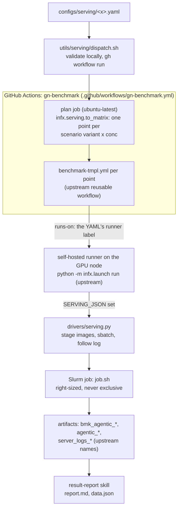
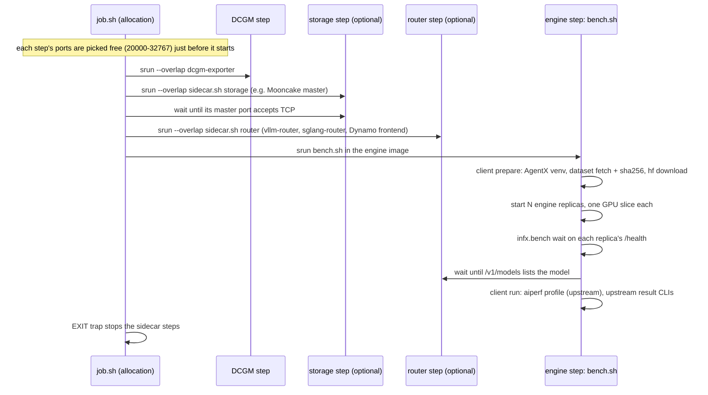
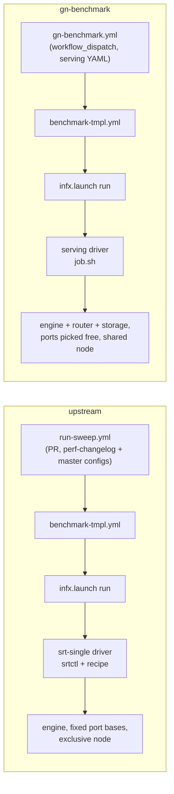

# gn-benchmark: architecture

## 1. What this is

gn-benchmark is how GreenNode benchmarks an LLM serving setup on its own Slurm GPU nodes with
the upstream InferenceX harness. One serving YAML describes the setup: the engine command (any
vLLM, SGLang or Dynamo launch), optionally a router in front of several engine replicas and a KV
storage service behind them, and the workload. Workloads cover:

- agentic replays: multi-turn coding agents, customer-service tool calling, voice-agent sessions;
- synthetic ISL/OSL/prefix-cache grids, at fixed concurrencies or with an SLO search that finds
  the highest concurrency that still meets the latency targets;
- custom datasets in the Mooncake trace format (shared-prefix and hidden-prefix traces, or any
  file you pin with a checksum).

One command dispatches the YAML to GitHub Actions. Each benchmark point comes back as an
upstream-format result artifact, which the `result-report` skill turns into a report.

The branch is upstream InferenceX plus one launch path, `serving`. Everything that measures is
upstream code, unchanged:

- upstream aiperf `aiperf==0.13.0.dev20261027` (pinned in `infx/bench/agentic/requirements.txt`;
  the retired `agentx-harness` wrapper is replaced by the `--scenario inferencex-agentx-mvp`
  defaults that `infx.bench.agentic.replay` passes explicitly);
  its venv comes from `infx.bench.agentic.venv`;
- the result CLIs in `infx.results.agentic` that aggregate and validate a run;
- the reusable workflow `benchmark-tmpl.yml`, `python -m infx.launch run`, cluster records,
  image staging and Slurm submit/follow/cancel in `SlurmBackend`.

The VNG part only turns a serving YAML into matrix points and, inside one Slurm job, starts the
containers the YAML names and points the harness at them. `git diff --stat --diff-filter=M upstream/main`
shows the four upstream files touched (section 4); `infx/bench` and `infx/results` have no VNG change.

Design and decisions: `docs/superpowers/specs/2026-10-25-vng-serving-refactor-design.md` (repo root).

## 2. The flow



Inside the Slurm job, every container is one step of the same allocation:



While the job waits for GPUs the driver prints one line a minute
(`Slurm job 6215 PENDING Resources (3m queued)`); once the job starts, its log streams
live into the Actions step. Cancelling the run cancels the Slurm job.

| Step | Where |
|---|---|
| Validate and dispatch | `inferencex-e2e/utils/serving/dispatch.sh` |
| Points | `infx/serving/to_matrix.py:56` (`build`), rows at `:22`, `SERVING_JSON` at `:32` |
| Serving YAML schema | `infx/serving/schema.py:123` (`ServingSpec`), `:256` (`load_serving`) |
| Scenario render | `infx/serving/scenarios.py:173` (`render`) |
| Routing hook | `infx/launch/policy.py:87` |
| Driver | `infx/launch/drivers/serving.py:111` (`run`); queue notes `:29` (`wait_started`); job env `:84` |
| Port picking | `benchmarks/single_node/serving/job.sh:16`, router metrics `:97` |
| DCGM / storage / router / engine steps | `job.sh:52`, `:63`, `:102`, `:113` |
| Replicas, one GPU slice each | `bench.sh:57` |
| Client prepare / run | `bench.sh:25`, `bench.sh:106`; `infx/serving/client.py:58`, `:72` |

**Remote endpoint.** A YAML with `endpoint:` launches nothing. Its point runs the client image
(`ghcr.io/astral-sh/uv:python3.12-bookworm-slim`); the driver `sbatch`es `remote.sh` with 16 CPUs,
64 GB and no GPU, keeping only the node pin from the cluster record (`submit_remote` in
`infx/launch/drivers/serving.py`). `remote.sh` runs one client step: `prepare` probes the endpoint
(key, model, usage reporting) and `run` replays the scenario against it with `--api-key`. The key
is the GitHub secret the YAML names, passed as `SERVING_API_KEY`.

## 3. How this differs from the upstream Slurm path

Upstream runs a single-node point through `srt-single`: `run-sweep.yml` plans points from
`perf-changelog.yaml` against the master configs (`configs/nvidia-master.yaml`, `amd-master.yaml`), and the driver clones srt-slurm, binds a recipe
variant and lets `srtctl` start the engine. gn-benchmark keeps the template workflow, the
launcher, the harness and the result code, and replaces the entry workflow and the driver.



| | upstream `srt-single` | gn-benchmark `serving` |
|---|---|---|
| Entry | `run-sweep.yml` on PRs, points from `perf-changelog.yaml` + master configs | `gn-benchmark.yml` by `workflow_dispatch`, points from one serving YAML |
| What starts the engine | `srtctl` with a recipe from `configs/srt-recipes` | the YAML's own command, rendered by `infx/serving/render.py` |
| Router / KV storage | recipe-defined | any image + command as `--overlap` sidecar steps |
| Node use | often `--exclusive`; srtctl uses fixed port bases | GPUs, 16 CPU/GPU and a memory share per GPU; every port picked free at run time |
| Clusters | workspace on Lustre or rsynced to the compute node | one cluster record per node; runner, HF cache and squash files on that node's disk |
| Scenarios | upstream AgentX configs | six base files + validated overrides, synthetic grid, SLO search |
| Harness, aiperf, result format | `agentx-harness`, `infx.results` | same |
| Artifacts | `bmk_agentic_*`, `agentic_*` | same names; aggregate `scenario` holds the legacy label |

VNG needs its own path because of how its nodes are used: they are shared with the team and have
no usable shared filesystem, while srtctl assumes exclusive nodes with fixed ports.

## 4. Where VNG code lives

Most VNG files have `serving` in their path. The exceptions are the workflow, the `result-report`
skill, the VNG block of `configs/runners.yaml` and the design docs. `git diff --stat upstream/main`
lists every one of them.

| File | Job |
|---|---|
| `benchmarks/single_node/serving/datasets/lock.yaml` | pinned file datasets, with `entries` |
| `infx/serving/datasets.py` | read the lock, fetch and sha256-check one dataset |
| `infx/serving/slo.py` | parse `metric:stat:op:threshold;...` |
| `benchmarks/single_node/serving/scenarios/*.yaml` | the six base AIPerf configs |
| `infx/serving/scenarios.py` | base + overrides / grid point / search / slo → final config and legacy label |
| `configs/runners.yaml` (VNG block) | VNG runner labels and cluster records |
| `infx/serving/schema.py`, `render.py` | serving YAML model and validation; command rendering |
| `infx/serving/to_matrix.py`, `utils/serving/dispatch.sh`, `.github/workflows/gn-benchmark.yml` | points; local validation and dispatch; the `gn-benchmark` workflow |
| `infx/serving/client.py`, `sweep_result.py` | in-container client; search result writer |
| `benchmarks/single_node/serving/{job,bench,sidecar}.sh` | allocation steps; engine step; router/storage sidecar |
| `infx/launch/drivers/serving.py` | the launch path |
| `configs/serving/*.yaml` | seven examples, one per pattern |
| `.agents/skills/{serving-bench,serving-runner-setup,result-report}` | skills |

Paths are relative to `inferencex-e2e/` except the workflow and the skills.

Upstream files touched (the only places a merge can conflict; four files, five spots):

1. `configs/runners.yaml`: the VNG labels after the last upstream label, the VNG cluster records at the end of `clusters:`.
2. `infx/launch/policy.py:63`: `SERVING = "serving"` in `LaunchPath`; `:87-88`: return it when `SERVING_JSON` is set.
3. `infx/launch/drivers/__init__.py`: `serving` in the driver import, and `LaunchPath.SERVING: Route("slurm", serving.run)` in `ROUTES`.
4. `.github/workflows/benchmark-tmpl.yml:8`: the optional `serving` input; `:99`: `SERVING_JSON: ${{ inputs.serving }}`.
5. `.github/workflows/benchmark-tmpl.yml:311`: "Validate agentic result" is skipped for search points, which have no top-level `profile_export_aiperf.json`.

## 5. VNG Slurm

The GPU nodes sit in one Slurm cluster with pyxis/enroot containers. They have no usable shared
filesystem and they are shared with the rest of the team. Both facts shape the design below.

### One cluster record per node

Without a shared filesystem, each GitHub runner lives on its GPU node, and the HF cache and squash
files sit on that node's local disk. So each node is its own cluster record in
`configs/runners.yaml`, pinned to its node with `--nodelist` in `salloc-args`. The record also
holds the partition, the account, the GPU count and the two local paths.

Records are grouped into pools by GPU type and site. A serving YAML's `runner:` takes a pool label
(any free node of that type), a `cluster:<id>` label (one node) or a single runner slot. The label
goes straight into `runs-on`.

### Runner convention

Every node follows the same convention: one service user that owns the enroot credentials and the
HF token, runner slots named `<cluster-id>_<NN>` with exactly one `cluster:<cluster-id>` label,
a directory per slot under the node's local disk, and systemd to keep them running. Slots per
node = the most jobs you want at once; Slurm queues a job that finds too few free GPUs. The
`serving-runner-setup` skill has the setup and preflight steps.

### Right-sized jobs, never exclusive

The nodes are shared with the team. A job asks for its GPUs
(`gres`), 16 CPUs per GPU and a per-GPU memory share sized to the node, and the rest of the node
stays free. These live in `salloc-args` because upstream `submit_batch` adds no
CPU or memory flags of its own; it passes `salloc-args` to `sbatch`.

### Ports picked at run time

Pyxis containers share the host network, and other jobs can run on the
same node, so fixed port bases would collide. `job.sh:16` picks each port free on the node from
20000-32767, below the Linux ephemeral range, right before the step that needs it: DCGM, the
storage master and metadata ports, the engine (one port per replica behind a router), the
router, the router metrics port when the router command uses `{{router_metrics_port}}`, and
Dynamo's system port. A serving YAML never writes a literal port.

### Squash import

Squash records use `import: submit-host` and `single-node-import: true`. The runner sits on the node where the
job runs, so the image is imported where it is used.

An image can also be a squash file already on a node (`image: /data/<dir>/<name>.sqsh`), for
example one built with enroot. It runs as is and is never imported. Validation requires a runner
that resolves to one node (`cluster:<id>` or one slot), and before `sbatch` the driver checks on
that node that the file exists, is readable by the runner user and passes `unsquashfs -l`. Images
that several nodes need belong in a registry, where every node caches its own squash.

## 6. Scenarios

Eight base files in `benchmarks/single_node/serving/scenarios/`:

| Family | Workload | Dataset |
|---|---|---|
| `agentx` | multi-turn coding agent | public AgentX trace |
| `tau2` | customer-service agent with tool calls | pinned file |
| `livekit` | voice-agent sessions | pinned file, Mooncake trace format |
| `shared-prefix-e2` | requests sharing long prefixes | pinned file, Mooncake trace format |
| `hidden-prefix-e3` | prefixes reused without being visible to the router | pinned file, Mooncake trace format |
| `synthetic` | generated ISL/OSL with a shared-prefix share | synthetic |
| `greenspec` | speculative-decoding bench cut from production chat traffic, one request per row | pinned private file (`Green-Lab/GreenSpec`), `raw_payload` format |
| `speedbench` | SPEED-Bench acceptance-length prompts, one request per row | pinned files (`Green-Lab/speed-bench-prepared`, a private copy of public data), `raw_payload` format |

Pinned files are listed in `benchmarks/single_node/serving/datasets/lock.yaml` with their URL and
sha256; the client downloads and checks them before the run.

A serving YAML picks a family and may set `overrides`. The keys allowed are `duration`, `dataset`
(same kind only: public to public, lock to lock), `max_context_length` (`null` removes the cap),
`generation` and `trace_idle_gap_cap`. Any other key fails validation, so cache-bust, warmup and seed
cannot change without a code review.

`greenspec` takes its own keys instead: `subset` (`diverse`, `agentic_coding`, `agentic_tools`, `llm_task`),
`lite`, `bucket`, `mode` (`target-default` or `recorded` sampling), `max_tokens` (output cap, default 8192)
and `requests` (default: the whole selection). It has no duration; the run ends when the selection is sent.
Three things differ from the other families:

- The dataset is private and the benchmark repo is public, so the client (`infx/serving/greenspec.py`)
  prints AgentX's console without error text, and before the upload keeps only an allowlist of files in
  `results/`, strips error messages from the aiperf export, replaces server logs by a stub (the originals
  stay on the node in `.greenspec-private-logs/`) and fails the job if a `question_id` is still in an
  upload. The request bodies are written outside `results/` and deleted at the end.
- The client snapshots the engine's `vllm:spec_decode_*` counters (`sglang:spec_accept_length` on SGLang)
  before and after the replay and files `spec_decode` (`acceptance_length`, `acceptance_rate`, counts) in
  the aggregate result (`infx/serving/specdec.py`). A point without speculative decoding has no such block.
- The runner needs `GREENLAB_HF_TOKEN` in `actions-runner/.env`: the release is not public.

`speedbench` follows the same pattern (no duration, the `spec_decode` block, `GREENLAB_HF_TOKEN`) with its own
keys: `config` (`qualitative`, default, or `throughput_1k` ... `throughput_32k`), `category` (one of
that config's categories; default all), `max_tokens` (default 4096), `temperature` (1.0), `top_p` (0.95),
`chat_template_kwargs` (the thinking switch, e.g. `enable_thinking: false`) and `requests`. The defaults are the
golden AL matrices'. A request is the first turn of a row alone, as the aiperf and vLLM SPEED-Bench loaders send
it. The result label carries every non-default key (`speedbench-qualitative-coding-ctk-enable_thinking-false`),
so runs that differ in thinking mode never share a summary row. The files are the fully resolved copy of
`nvidia/SPEED-Bench`: the public release masks about 60% of the qualitative rows. The prompts are public, so
none of GreenSpec's guard applies: console, server log and results upload as for any other family.

A base arm and a speculative arm are the `arms:` of one serving YAML (below). The `summary` job of
`gn-benchmark.yml` prints one table of all points of a run on the run page, with the speedup of each
speculative point over the base point of the same scenario and concurrency.

### Arms

`arms:` runs engine variants of one serving YAML in one run: `serve:` and `env:` are shared, an arm adds
flags with `append` and overlays `env`. Each arm is its own job on its own engine (the name of the point
is `<name>-<arm>_c<conc>`), so arms multiply with `conc` and with a workload grid.

```yaml
serve: vllm serve <model> --tensor-parallel-size 1 ...
arms:
  base: {}
  mtp6:
    append: |
      --speculative-config '{"method": "mtp", "model": "<draft>", "num_speculative_tokens": 6}'
```

Two arms that end up with the same command and env are rejected, and `arms:` does not combine with
`endpoint:`. The `spec-decoding` field of each point follows its own command (`mtp`, `draft_model` or `none`).

The synthetic family takes `workload:` instead:

```yaml
scenario: synthetic
workload: {isl: [8k, 32k], osl: ['512', 1k], cache: [0, 50, 90], search: true}
slo: "inter_token_latency:p90:lt:10"   # optional; replaces the default SLO
conc: 1                                # search finds the concurrency itself
```

Every ISL x OSL x cache point becomes one job in the same workflow run. `search: false` runs the
points at a fixed concurrency instead: a grid of several points takes exactly one `conc`, a single
point may list several.

Old scenario names map to the new syntax like this:

| Old `scenario:` | New |
|---|---|
| `agentx-cc-062126` | `scenario: agentx` |
| `agentx-cc-062126-smoke` | `scenario: agentx` + `overrides: {duration: 180}` |
| `agentx-cc-062126-256k` | `scenario: agentx` + `overrides: {dataset: semianalysis_cc_traces_weka_062126_256k}` |
| `agentx-cc-062126-1m` | `scenario: agentx` + `overrides: {max_context_length: null}` |
| `agentx-cc-062126-topp95` | `scenario: agentx` + `overrides: {generation: {top_p: 0.95, temperature: 1.0}}` |
| `custom-agentic-tau2[-smoke]` | `scenario: tau2` (smoke: + `overrides: {duration: 180}`) |
| `custom-agentic-livekit111868-v1.1-warm` | `scenario: livekit` |
| `custom-agentic-livekit111868-v1` / `-v2` | `scenario: livekit` + `overrides: {dataset: livekit-111868-v1}` / `v2` |
| `custom-agentic-livekit111868-smoke` | `scenario: livekit` + `overrides: {dataset: livekit-111868-v2, duration: 180}`; the label becomes `custom-agentic-livekit111868-v2-smoke` |
| `agentx-shared-prefix-e2` | `scenario: shared-prefix-e2` |
| `agentx-hidden-prefix-e3[-smoke]` | `scenario: hidden-prefix-e3` (smoke: + `overrides: {duration: 180}`) |
| `sweep-isl<I>-osl<O>-cache<C>` | `scenario: synthetic` + `workload: {..., search: true}` + `conc: 1` |
| `fixed-isl<I>-osl<O>-cache<C>` | `scenario: synthetic` + `workload: {..., search: false}`, one `conc` per grid (a single point may list several) |
| `IX_SLO` in `env:` | `slo: "<same tuples>"` |

`infx/tests/serving/test_scenarios.py` checks parity: for each of the 20 legacy files kept as
fixtures in `infx/tests/serving/legacy_scenarios/`, base plus overrides renders the same YAML
document, comments aside.

LiveKit warm is a dataset, nothing more. aiperf TTFT therefore includes the 601 dial warm-up
requests (`max_tokens 1`), so avg and p50 TTFT read lower than the warm-up-filtered numbers in older
reports.

## 7. Results

Artifact names are upstream's (`bmk_agentic_<RF>`, `agentic_<RF>`). Exp-names keep the old rule:
`<name>-<label>` when the workload grid has more than one point, otherwise `<name>_search` for a
search and `<name>_c<conc>` for each concurrency.

`results/` in each artifact holds `serving.yaml`, `scenario.yaml`, `server[.N].log`,
`server_command[.N].txt`, `router.log`, `router_command.txt`, `storage.log`,
`storage_command.txt`, `dcgm.log`, `benchmark.log`, `benchmark_command.txt`, `dataset.txt` for
file datasets, and `aiperf_artifacts/`.

The aggregate JSON's `scenario` field holds the legacy label, with the one exception in the table
of section 6 (`agentx-cc-062126-smoke`,
`sweep-isl8k-osl1k-cache50`, ...). Search points carry a `state`: `ok`, `cliff`,
`no_pass_in_range`, `no_failure_in_range`, `max_iterations` or `no_data`.

`.agents/skills/result-report` turns run links into `report.md` / `data.json`. It reads the
scenario from the aggregate first (`scenario_of` in `scripts/extract.py`).

## 8. Syncing upstream

```bash
git fetch upstream && git merge upstream/main
```

Conflicts can only land in the five touch points of section 4. After the merge, from
`inferencex-e2e/`:

```bash
git submodule update --init utils/srt-slurm
uv run --no-project --python 3.12 --with pytest --with ./utils/srt-slurm python -m pytest infx/tests/serving infx/tests/launch -q
```

Then check that these still exist with the same shape: `infx.bench.agentic.venv` (`Runtime`,
`bootstrap`), the `infx.bench wait` CLI, `SlurmBackend.stage_image` / `submit_batch` /
`stream_logs` / `state`, and the private `infx.results.agentic` helpers imported by
`infx/serving/sweep_result.py` (`_env_bool`, `_env_int`, `_gpu_shape`,
`_optional_component_metadata`, `_validate_kv_offload_env`). The serving tests fail if any of
them moves.

## 9. Not done here

- Multi-node PD disaggregation (upstream `srt-multi` and srt recipes).
- Single-node PD through `roles:` in the serving driver.
- Features still on unmerged branches of the old flow: adaptive search on trace scenarios,
  LiveKit open-loop, late-joining replicas (`scale_up`), `host_cpus` / `host_mem_gb`, and
  warm-up-filtered TTFT.
- The VNG fix that counts Mooncake `storage_*` hits as external cache hits in
  `infx/results/agentic/backends/sglang.py` is not ported. Aggregates of L3 runs under-report
  `server_external_cache_hit_rate`; `result-report` computes the tiers from raw metrics and is not
  affected. Candidate for an upstream PR.
- The other 46 legacy serving YAMLs stay on `vng-benchmark`; convert them with the table in
  section 6 when needed.
