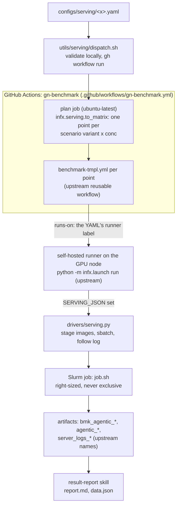
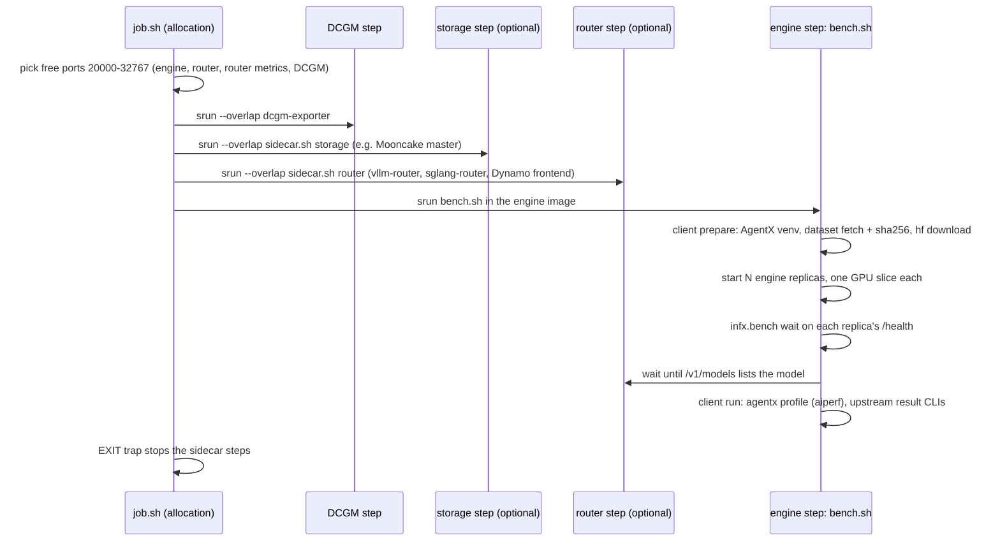
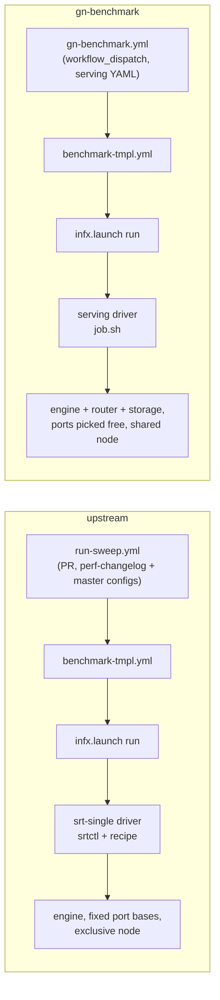

# gn-benchmark: architecture

## 1. What this is

gn-benchmark is how GreenNode benchmarks an LLM serving setup on its own Slurm GPU nodes with
the upstream InferenceX harness. You write one serving YAML: the engine command (vLLM, SGLang,
Dynamo), an optional router and an optional KV storage service, the scenario (AgentX, tau2,
LiveKit, E2/E3 prefix traces, or a synthetic ISL/OSL/cache grid) and the concurrencies or an
SLO search. One command dispatches it to GitHub Actions, and each point comes back as an
upstream-format result artifact that `result-report` reads.

The branch is upstream InferenceX plus one launch path, `serving`. Everything that measures is
upstream code, unchanged:

- the AgentX harness `agentx-harness==1.0.12` (pinned in `infx/bench/agentic/requirements.txt`),
  which runs aiperf; its venv comes from `infx.bench.agentic.venv`;
- the result CLIs in `infx.results.agentic` that aggregate and validate a run;
- the reusable workflow `benchmark-tmpl.yml`, `python -m infx.launch run`, cluster records,
  image staging and Slurm submit/follow/cancel in `SlurmBackend`.

The VNG part only turns a serving YAML into matrix points and, inside one Slurm job, starts the
containers the YAML names and points the harness at them. `git diff upstream/main --stat` shows
four upstream files touched (section 4); `infx/bench` and `infx/results` have no VNG change.

Design and decisions: `docs/superpowers/specs/2026-10-25-vng-serving-refactor-design.md` (repo root).

## 2. The flow



Inside the Slurm job, every container is one step of the same allocation:



While the job waits for GPUs the driver prints one line a minute
(`Slurm job 6215 PENDING Resources (null) (3m queued)`); once the job starts, its log streams
live into the Actions step. Cancelling the run cancels the Slurm job.

| Step | Where |
|---|---|
| Validate and dispatch | `inferencex-e2e/utils/serving/dispatch.sh` |
| Points | `infx/serving/to_matrix.py:56` (`build`), rows at `:22`, `SERVING_JSON` at `:32` |
| Serving YAML schema | `infx/serving/schema.py:123` (`ServingSpec`), `:256` (`load_serving`) |
| Scenario render | `infx/serving/scenarios.py:173` (`render`) |
| Routing hook | `infx/launch/policy.py:87` |
| Driver | `infx/launch/drivers/serving.py:111` (`run`); queue notes `:29` (`wait_started`); job env `:84` |
| Port picking | `benchmarks/single_node/serving/job.sh:16`, router metrics `:97` |
| DCGM / storage / router / engine steps | `job.sh:52`, `:63`, `:102`, `:113` |
| Replicas, one GPU slice each | `bench.sh:57` |
| Client prepare / run | `bench.sh:25`, `bench.sh:106`; `infx/serving/client.py:58`, `:72` |

If the engine or router dies before it is ready, the wait fails and prints the tail of
`server.log` or `router.log`.

## 3. How this differs from the upstream Slurm path

Upstream runs a single-node point through `srt-single`: `run-sweep.yml` plans points from
`perf-changelog.yaml` against the master configs (`configs/nvidia-master.yaml`, `amd-master.yaml`), and the driver clones srt-slurm, binds a recipe
variant and lets `srtctl` start the engine. gn-benchmark keeps the template workflow, the
launcher, the harness and the result code, and replaces the entry workflow and the driver.



| | upstream `srt-single` | gn-benchmark `serving` |
|---|---|---|
| Entry | `run-sweep.yml` on PRs, points from `perf-changelog.yaml` + master configs | `gn-benchmark.yml` by `workflow_dispatch`, points from one serving YAML |
| What starts the engine | `srtctl` with a recipe from `configs/srt-recipes` | the YAML's own command, rendered by `infx/serving/render.py` |
| Router / KV storage | recipe-defined | any image + command as `--overlap` sidecar steps |
| Node use | often `--exclusive`; srtctl uses fixed port bases | GPUs, 16 CPU/GPU and a memory share per GPU; every port picked free at run time |
| Clusters | workspace on Lustre or rsynced to the compute node | one cluster record per node; runner, HF cache and squash files on that node's disk |
| Scenarios | upstream AgentX configs | six base files + validated overrides, synthetic grid, SLO search |
| Harness, aiperf, result format | `agentx-harness`, `infx.results` | same |
| Artifacts | `bmk_agentic_*`, `agentic_*` | same names; aggregate `scenario` holds the legacy label |

VNG needs its own path because of how its nodes are used: they are shared with the team and have
no usable shared filesystem, while srtctl assumes exclusive nodes with fixed ports.

## 4. Where VNG code lives

Every VNG file has `serving` in its path, so `git grep -l serving` or
`git diff upstream/main --stat` lists all of it.

| File | Job |
|---|---|
| `benchmarks/single_node/serving/datasets/lock.yaml` | pinned file datasets, with `entries` |
| `infx/serving/datasets.py` | read the lock, fetch and sha256-check one dataset |
| `infx/serving/slo.py` | parse `metric:stat:op:threshold;...` |
| `benchmarks/single_node/serving/scenarios/*.yaml` | the six base AIPerf configs |
| `infx/serving/scenarios.py` | base + overrides / grid point / search / slo → final config and legacy label |
| `configs/runners.yaml` (VNG block) | `hcm-*` runner labels and cluster records |
| `infx/serving/schema.py`, `render.py` | serving YAML model and validation; command rendering |
| `infx/serving/to_matrix.py`, `utils/serving/dispatch.sh`, `.github/workflows/gn-benchmark.yml` | points; local validation and dispatch; the `gn-benchmark` workflow |
| `infx/serving/client.py`, `sweep_result.py` | in-container client; search result writer |
| `benchmarks/single_node/serving/{job,bench,sidecar}.sh` | allocation steps; engine step; router/storage sidecar |
| `infx/launch/drivers/serving.py` | the launch path |
| `configs/serving/*.yaml` | seven examples, one per pattern |
| `.agents/skills/{serving-bench,serving-runner-setup,result-report}` | skills |

Paths are relative to `inferencex-e2e/` except the workflow and the skills.

Upstream files touched (the only places a merge can conflict; four files, five spots):

1. `configs/runners.yaml`: the VNG labels after the last upstream label, the four `hcm-*` records at the end of `clusters:`.
2. `infx/launch/policy.py:63`: `SERVING = "serving"` in `LaunchPath`; `:87-88`: return it when `SERVING_JSON` is set.
3. `infx/launch/drivers/__init__.py`: `serving` in the driver import, and `LaunchPath.SERVING: Route("slurm", serving.run)` in `ROUTES`.
4. `.github/workflows/benchmark-tmpl.yml:8`: the optional `serving` input; `:99`: `SERVING_JSON: ${{ inputs.serving }}`.
5. `.github/workflows/benchmark-tmpl.yml:311`: "Validate agentic result" is skipped for search points, which have no top-level `profile_export_aiperf.json`.

## 5. VNG Slurm

Facts measured on 2026-10-25: one cluster `test-cluster`, Slurm 26.11.0rc1, `select/cons_tres` with
`CR_CORE_MEMORY`, backfill, no preemption, pyxis on every node.

### One cluster record per node

There is no usable shared filesystem: `/shared` is a 492G NFS at
96%, and home directories are not shared. So each runner lives on its GPU node, and the HF cache
and squash files sit on that node's local disk. Each node is its own `clusters.hcm-<node>`, pinned
with `--nodelist` in `salloc-args`:

| Cluster | Node | Partition | GPUs | HF cache / squash |
|---|---|---|---|---|
| `hcm-hgx01` | hgx-h200-01 | `hardware-hcm` | 4 (gres declares 4 of 8; raise when infra fixes it) | `/mnt/hf_hub_cache`, `/mnt/containers` |
| `hcm-hgx02` | hgx-h200-02 | `hardware-hcm` | 8 | `/mnt/hf_hub_cache`, `/mnt/containers` |
| `hcm-rtx01` | hoanq3-rtx6000x2-slurm-1 | `rtx6000pro-hcm` | 2 | `/data/hf_hub_cache`, `/data/containers` |
| `hcm-rtx02` | hoanq3-rtx6000x2-slurm-2 | `rtx6000pro-hcm` | 2 | `/data/hf_hub_cache`, `/data/containers` |
| `han-h200-01` | hoanq3-h200-1x-han-1 | `test` | 1 | `/mnt/hf_hub_cache`, `/mnt/containers` |
| `han-h200-02` | hoanq3-h200-1x-han-2 | `test` | 1 | `/mnt/hf_hub_cache`, `/mnt/containers` |
| `han-h200-04` | hoanq3-h200-1x-han-4 | `test` | 1 | `/data/hf-cache`, `/data/containers` |

The serving YAML `runner:` takes a cluster label (`cluster:hcm-hgx02`), a pool label (`h200-hcm`,
`rtx6000pro-hcm`, `h200-han`) or one slot.

### Runner convention

Every pool uses the same convention: user `stackops` (enroot credentials and HF token in its
home), name `<cluster-id>_<NN>` with exactly one `cluster:<cluster-id>` label, directory
`<local disk>/gharunners/<cluster-id>/gharunnerNN/`, GitHub labels `slurm,<sku>,<pool>,cluster:<cluster-id>` (the YAML's `runner:` goes straight into `runs-on`), run by systemd. Slots per node = the most jobs you want at once
(hgx 4, rtx 2); Slurm queues a job that finds too few free GPUs. Setup and preflight:
`.agents/skills/serving-runner-setup`.

### Right-sized jobs, never exclusive

The nodes are shared with the team. A job asks for its GPUs
(`gres`), 16 CPUs per GPU and a per-GPU memory share (240000M on hgx, 110000M on rtx), and the
rest of the node stays free. These live in `salloc-args` because upstream `submit_batch` adds no
CPU or memory flags of its own; it passes `salloc-args` to `sbatch`.

### Ports picked at run time

Pyxis containers share the host network, and other jobs can run on the
same node, so fixed port bases would collide. `job.sh:16` picks each port free on the node from
20000-32767, below the Linux ephemeral range: engine, router, DCGM, and the router metrics port
when the router command uses `{{router_metrics_port}}`. A serving YAML never writes a literal port.

### Squash import

Squash records use `import: submit-host` and `single-node-import: true`. The runner sits on the node where the
job runs, so the image is imported where it is used.

## 6. Scenarios

Six base files in `benchmarks/single_node/serving/scenarios/`:

| Family | Dataset |
|---|---|
| `agentx` | public weka `062126` |
| `tau2` | lock `tau2-cs` |
| `livekit` | lock `livekit-111868-v1.1-warm` |
| `shared-prefix-e2` | lock `shared-prefix-e2` |
| `hidden-prefix-e3` | lock `hidden-prefix-e3` |
| `synthetic` | synthetic, with shared prefix |

A serving YAML picks a family and may set `overrides`. The keys allowed are `duration`, `dataset`
(same kind only: public to public, lock to lock), `max_context_length` (`null` removes the cap),
`generation` and `trace_idle_gap_cap`. Any other key fails validation, so cache-bust, warmup and seed
cannot change without a code review.

The synthetic family takes `workload:` instead:

```yaml
scenario: synthetic
workload: {isl: [8k, 32k], osl: ['512', 1k], cache: [0, 50, 90], search: true}
slo: "inter_token_latency:p90:lt:10"   # optional; replaces the default SLO
conc: 1                                # search finds the concurrency itself
```

Every ISL x OSL x cache point becomes one job in the same workflow run. `search: false` runs each
point at the `conc` values instead.

Old scenario names map to the new syntax like this:

| Old `scenario:` | New |
|---|---|
| `agentx-cc-062126` | `scenario: agentx` |
| `agentx-cc-062126-smoke` | `scenario: agentx` + `overrides: {duration: 180}` |
| `agentx-cc-062126-256k` | `scenario: agentx` + `overrides: {dataset: semianalysis_cc_traces_weka_062126_256k}` |
| `agentx-cc-062126-1m` | `scenario: agentx` + `overrides: {max_context_length: null}` |
| `agentx-cc-062126-topp95` | `scenario: agentx` + `overrides: {generation: {top_p: 0.95, temperature: 1.0}}` |
| `custom-agentic-tau2[-smoke]` | `scenario: tau2` (smoke: + `overrides: {duration: 180}`) |
| `custom-agentic-livekit111868-v1` / `-v2` | `scenario: livekit` + `overrides: {dataset: livekit-111868-v1}` / `v2` |
| `custom-agentic-livekit111868-smoke` | `scenario: livekit` + `overrides: {dataset: livekit-111868-v2, duration: 180}` |
| `agentx-shared-prefix-e2` | `scenario: shared-prefix-e2` |
| `agentx-hidden-prefix-e3[-smoke]` | `scenario: hidden-prefix-e3` (smoke: + `overrides: {duration: 180}`) |
| `sweep-isl<I>-osl<O>-cache<C>` | `scenario: synthetic` + `workload: {..., search: true}` + `conc: 1` |
| `fixed-isl<I>-osl<O>-cache<C>` | `scenario: synthetic` + `workload: {..., search: false}`, same `conc` list |
| `IX_SLO` in `env:` | `slo: "<same tuples>"` |

`infx/tests/serving/test_scenarios.py` checks parity: for each of the 20 legacy files kept as
fixtures in `infx/tests/serving/legacy_scenarios/`, base plus overrides renders the same YAML
document, comments aside.

LiveKit warm is a dataset, nothing more. aiperf TTFT therefore includes the 601 dial warm-up
requests (`max_tokens 1`), so avg and p50 TTFT read lower than the warm-up-filtered numbers in older
reports.

## 7. Results

Artifact names are upstream's (`bmk_agentic_<RF>`, `agentic_<RF>`). Exp-names keep the old rule:
`<name>_c<conc>`, `<name>_search`, and `<name>-<label>` for grid points.

`results/` in each artifact holds `serving.yaml`, `scenario.yaml`, `server[.N].log`,
`server_command[.N].txt`, `router.log`, `router_command.txt`, `storage.log`,
`storage_command.txt`, `dcgm.log`, `benchmark.log`, `benchmark_command.txt`, `dataset.txt` for
file datasets, and `aiperf_artifacts/`.

The aggregate JSON's `scenario` field holds the legacy label (`agentx-cc-062126-smoke`,
`sweep-isl8k-osl1k-cache50`, ...). Search points carry a `state`: `ok`, `cliff`,
`no_pass_in_range`, `no_failure_in_range`, `max_iterations` or `no_data`.

`.agents/skills/result-report` turns run links into `report.md` / `data.json`. It reads the
scenario from the aggregate first (`scenario_of` in `scripts/extract.py`).

## 8. Syncing upstream

```bash
git fetch upstream && git merge upstream/main
```

Conflicts can only land in the five touch points of section 4. After the merge, from
`inferencex-e2e/`:

```bash
git submodule update --init utils/srt-slurm
uv run --no-project --python 3.12 --with pytest --with ./utils/srt-slurm python -m pytest infx/tests/serving infx/tests/launch -q
```

Then check that these still exist with the same shape: `infx.bench.agentic.venv` (`Runtime`,
`bootstrap`), the `infx.bench wait` CLI, `SlurmBackend.stage_image` / `submit_batch` /
`stream_logs` / `state`, and the private `infx.results.agentic` helpers imported by
`infx/serving/sweep_result.py` (`_env_bool`, `_env_int`, `_gpu_shape`,
`_optional_component_metadata`, `_validate_kv_offload_env`). The serving tests fail if any of
them moves.

## 9. Not done here

- Multi-node PD disaggregation (upstream `srt-multi` and srt recipes).
- Single-node PD through `roles:` in the serving driver.
- Features still on unmerged branches: adaptive search on trace scenarios
  (`bench/gemma4-livekit-dyn-swa-arms`), LiveKit open-loop (`bench/gemma4-livekit-voice-openloop`),
  late-joining replicas / `scale_up` (`feat/serving-late-replica-mooncake`), `host_cpus` /
  `host_mem_gb` (`feat/serving-dynamo-vllm-replicas`), warm-up-filtered TTFT (`livekit_ttft.py`).
- The VNG fix that counts Mooncake `storage_*` hits as external cache hits in
  `infx/results/agentic/backends/sglang.py` is not ported. Aggregates of L3 runs under-report
  `server_external_cache_hit_rate`; `result-report` computes the tiers from raw metrics and is not
  affected. Candidate for an upstream PR.
- The other 46 legacy serving YAMLs stay on `vng-benchmark`; convert them with the table in
  section 6 when needed.
